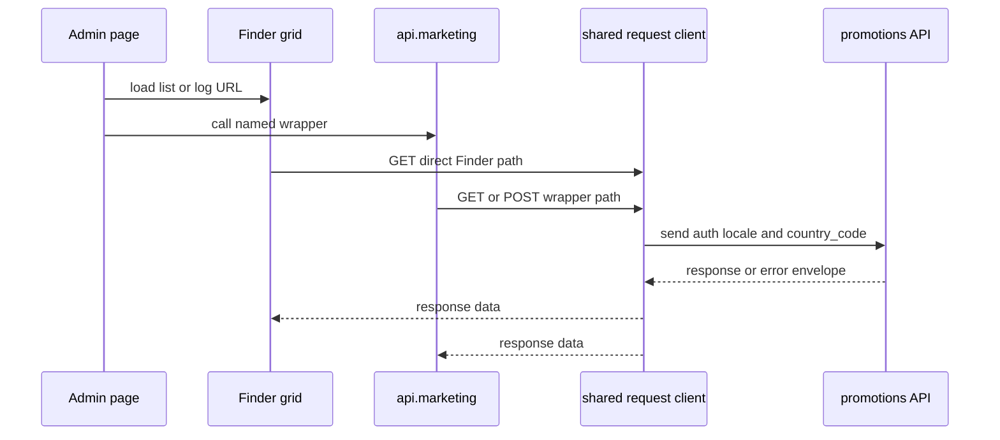
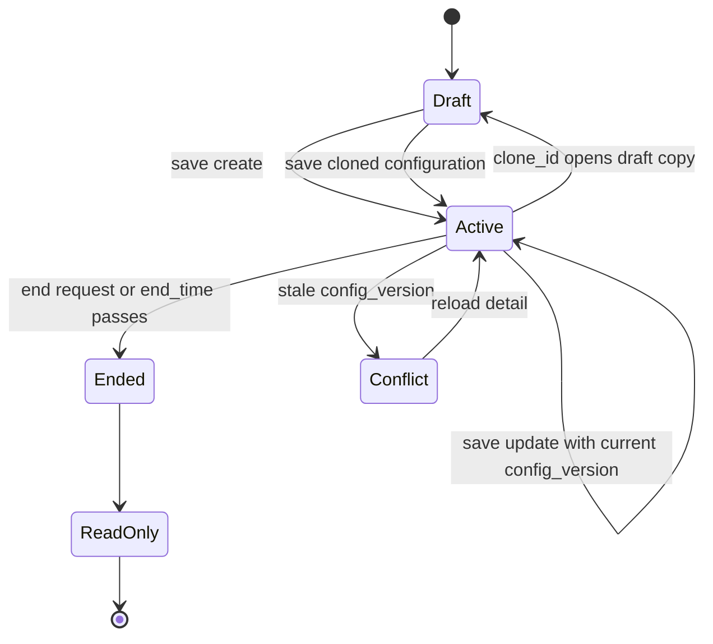

# Lottery Wheel Admin and API Contract

> **Authority:** INT-01 is the Admin integration authority. The repository requirements page uses the GitLab PRD only for business-rule conflicts explicitly recorded there; HTTP paths and error codes remain governed by INT-01.
>
> **Scope:** This page documents the Admin contract implemented by the current Vue application. The Admin manages activity configuration, lifecycle controls, activity selection, and reports. User-facing Vshop/H5 behavior is outside this page; the only relevant boundary is that those clients consume the published activity rather than use the Admin configuration/reporting endpoints.

## Contract boundary and transport

The lottery Admin uses the domain module assembled as `api.marketing`. Its named wrappers are in `src/api/marketing.js`; the list and log grids also use Finder URLs directly. All requests go through `src/api/request/index.js` and the `RequestClient` in `src/api/request/request.js`.

The deployed API host is `VUE_APP_BASE_API`. Endpoint paths below are the repository paths after that base URL. The shared client provides a 30-second timeout, JSON defaults, bearer authorization when a token exists, and an `Accept-Language` header. It adds the locale-derived `country_code` unless a request opts out. For GET requests, the request interceptor merges `data` into query parameters, removes empty-string values, and removes the request body.

This diagram shows the two repository entrypoints converging on the shared transport.

The response interceptor treats an HTTP 2xx or 3xx response without `status_code` as a successful protocol response. Other responses are rejected. HTTP 401 clears the user/system session and redirects to the matching portal login; other failures may show the backend `data.error` or `data.message` unless the request sets `showError: false`. `src/api/index.js` then unwraps successful responses for Vue callers by returning `response.data.data`.

## Admin endpoint matrix

The following paths and methods are verified against the current wrappers and callers. `Direct Finder` means the component passes the URL to `SpFinder`; it is not a named function in `src/api/marketing.js`.

| Capability | Method | Repository path | Entry point | Request mapping |
| --- | --- | --- | --- | --- |
| Activity list | GET | `/promotions/getturntableList` | Direct Finder in `list.vue` and `picker-lottery.vue` | `activity_id`, `activity_name`, optional `status`, plus Finder paging |
| Activity detail | GET | `/promotions/getturntable` | `marketing.getTurntableDetail` | `{ id }` |
| Save configuration | POST | `/promotions/turntableconfig` | `marketing.editTurntableConfig` | JSON-stringified `prize_data` and `activity_template_config`; update also sends `id` and `config_version` |
| Log list | GET | `/promotions/getturntable_log/byid` | Direct Finder in `schema.js` | `activity_id`; `pageSize` is copied to backend field `page_size` by the Finder hook |
| Summary counts | GET | `/promotions/getturntable_count/byid` | `marketing.getTurntableCountById` | `{ activity_id }` |
| End activity | GET | `/promotions/down_lucky_draw/byid` | `marketing.downLuckyDrawById` | `{ activity_id }` |
| Export report | GET | `/promotions/down_lucky_draw/export` | `marketing.exportLuckyDrawData` | `{ activity_id }`; success redirects to the export-record page |
| Optional server-side copy | POST | `/promotions/turntable/copy` | `marketing.copyTurntable` | Wrapper exists, but the Admin primary copy flow is draft cloning in the editor, not this call |

The older `src/api/promotions.js` also contains `getSurntableconfig` and `setSurntableconfig` for GET/POST `/promotions/turntableconfig`. The current lottery Admin page uses the `marketing.js` wrappers and direct Finder URLs described above; do not infer a separate endpoint from the older function names.

## Configuration request

### Create and update

The editor builds the save payload in `editor.vue` and calls `marketing.editTurntableConfig`:

| Field | Create | Update | Mapping and invariant |
| --- | --- | --- | --- |
| `id` | omitted | included | Route `:id` identifies an edit; clone mode removes it before save |
| `config_version` | omitted | included | Read from detail and sent for optimistic concurrency |
| `activity_name` | sent | sent | Admin display name |
| `intro` | required by editor | required by editor | Rich-text description; blank/HTML-only content is rejected client-side |
| `activity_type` | fixed | fixed | Always `wheel` |
| `cost_value` | numeric | locked in the editor | Serialized as a number and validated as at least 1 by the current editor |
| `limit_total` | number, default `0` | number | Empty/negative input normalizes to `0`; `0` means no total limit in the Admin UI |
| `limit_day` | number, default `0` | number | Empty/negative input normalizes to `0`; cannot exceed a positive total limit |
| `begin_time`, `end_time` | Unix seconds | Unix seconds | Built from the date range; update keeps the existing begin time and edits only the end time |
| `prize_data` | required | required | `JSON.stringify(buildPrizePayload())`; see the prize contract below |
| `activity_template_config` | sent | sent | `JSON.stringify(...)` containing wheel visual configuration and the prize copy used for rendering |

`cost_type` is displayed as a disabled value of `2` (points) but is not included in `submitAfter()`; the save payload fixes `activity_type` to `wheel` and does not send `area_id`. The requirements brief records the same Admin boundary and explicitly excludes `area_id`.

The editor validates `end_time > begin_time` and `end_time > now`, requires at least one `thanks` prize, requires the probability sum to be greater than zero and no more than 100, limits names to five characters, and rejects negative coupon/coupon-pack daily stock. It also caps coupon daily stock to the selected item’s available quantity when that quantity is present. These are UI validations; backend validation remains the final contract authority.

### Detail and edit lifecycle

`getTurntableDetail({ id })` supplies the editor with the existing activity. The editor restores `begin_time`/`end_time` as a date range, `config_version`, limits, description, prize rows, and the nested template configuration. Coupon values are normalized from `prize_detail.card_id`; coupon-pack values use `prize_detail.package_id`. A normal edit preserves the existing `prize_id` values. A clone loads the same detail with `clone_id`, appends ` 副本` to the name, clears the activity id and version, clears the date range for a new selection, and saves through the normal POST endpoint.

On a save response with `result`, the page returns to the lottery list. `LUCKY_DRAW_CONFIG_VERSION_CONFLICT` causes an error message and a detail reload; `LUCKY_DRAW_ENDED` switches the form to read-only. A detail whose `end_time` has passed is also made read-only in the editor. The source does not define a lottery-specific automated test suite, so these concurrency and terminal-state paths require focused manual API/UI verification.

This lifecycle reflects the editor’s create, update, draft-clone, optimistic-lock, and ended/read-only behavior.

## Prize data contract

The editor sends each prize as an object in the `prize_data` JSON array. The current field names are:

| Field | Meaning |
| --- | --- |
| `prize_id` | Preserved on an edit when present; omitted for a new row so the service can assign it |
| `sort` | Current row order, generated from the editor array index |
| `name` | Display name, maximum five characters in the editor |
| `type` | One of `thanks`, `points`, `coupon`, `coupons` |
| `value` | Points input for `points`; selected card id for `coupon`; selected package id for `coupons`; empty for `thanks` |
| `probability` | Integer percentage-like value constrained by the editor to 0 through 100; aggregate must be in `(0, 100]` |
| `dailyStock` | Sent for `coupon` and `coupons`, normalized to a number; `0` is the UI value for no daily stock |
| `backgroundColor` | Prize-sector color |
| `background` | Compatibility rendering field populated with the same color |
| `image` | Prize-sector image URL, or empty string |

At least one `thanks` row is required and cannot be deleted or renamed in the editor. The editor allows at most eight rows. The save payload does not perform legacy-key dual writes; it uses the current prize keys and serializes the complete array.

`activity_template_config` carries presentation state in addition to the canonical prize array: background image/color, `gameMarginTop` (default `150px`), wheel blocks, center button configuration, and rule/record button configuration. The editor copies the same normalized prize objects into `gameConfig.prizes` so the detail view and preview can restore the visual configuration.

## List, status, and reporting semantics

The Admin list uses `/promotions/getturntableList` directly. Its search fields are `activity_id` and `activity_name`. The `all` tab removes `status`; the other tabs send one of the exact values `notstart`, `online`, or `expire`. The UI displays the corresponding status labels and exposes the stop action only for `online` rows.

The activity picker used by decoration also calls the same direct list URL, searches by ID/name, and explicitly removes `status`, so it can select activities regardless of lifecycle status. This is an Admin integration boundary: it makes a configured activity selectable by another Admin workflow and does not describe the user-facing lottery client.

The list actions are:

- **Edit:** route to the activity editor with the row id.
- **Stop:** confirm, call `GET /promotions/down_lucky_draw/byid` with `activity_id`, then refresh the Finder.
- **Copy:** route to the editor with `?clone_id=<id>`; it is a draft copy saved through the normal configuration endpoint.
- **Statistics:** call the count wrapper with `activity_id`, then open the log dialog.

The statistics dialog uses the direct log URL with `activity_id`. Its visible columns are user ID, member code, prize title, prize type, and creation time. Member code display falls back in this order: `user_card_code`, `username`, `member_code`, `mobile`, then `-`. The summary response supplies the values shown above the log table, and export calls the named export wrapper before routing to `export_luckdraw_log` in the export-record area.

## Failure and verification expectations

The current Admin explicitly handles these named business failures:

- `LUCKY_DRAW_CONFIG_VERSION_CONFLICT`: the saved version is stale; reload detail and retry.
- `LUCKY_DRAW_ENDED`: the activity is terminal/read-only; stop editing and show the ended message.
- Any other rejected request: display the backend message when available, otherwise the generic operation failure.

HTTP 401 is a transport/authentication failure handled centrally by the shared client, not a lottery business status. Network errors and timeouts are also handled centrally. The repository has no lottery-specific test files or declared general test runner; verification should therefore cover the list filters, detail round trip, create/update payload serialization, stale-version response, ended activity, draft clone, stop action, log pagination mapping, statistics, export redirect, and selection of ended activities in the picker. Use the repository’s targeted checks and lint/build controls for broader regressions as described in `openwiki/operations/integrations-and-quality.md`.

## Source anchors

- `src/api/marketing.js`: named Admin wrappers and exact methods/paths.
- `src/api/promotions.js`: older turntable GET/POST wrappers; retained as a compatibility reference, not the current lottery page entrypoint.
- `src/api/request/index.js` and `src/api/request/request.js`: auth, locale, GET parameter, response, timeout, and 401 behavior.
- `src/view/marketing/lottery/list.vue`: list URL, actions, status query mapping, stop/statistics/export callers.
- `src/view/marketing/lottery/schema.js`: table columns, direct log URL, pagination field mapping, and summary display.
- `src/view/marketing/lottery/editor.vue`: detail loading, validation, payload serialization, clone/update behavior, and handled error codes.
- `src/view/marketing/lottery/editorSchema.js` and `src/view/marketing/lottery/constants.js`: form fields, prize types, defaults, and status values.
- `src/components/sp-picker/pickers/picker-lottery.vue`: Admin decoration picker boundary and unfiltered activity selection.
- `openwiki/marketing/lottery/requirements.md`: INT-01/PRD conflict policy and Admin scope.
