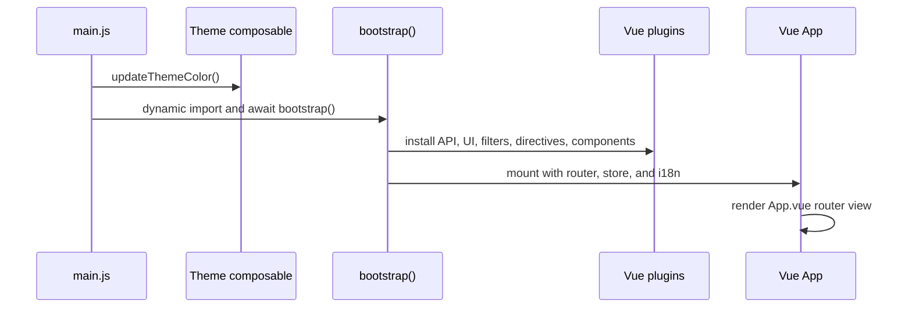
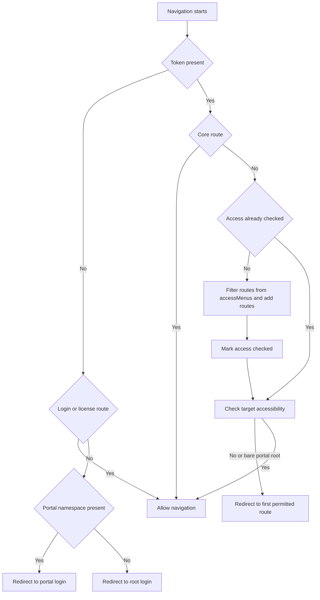
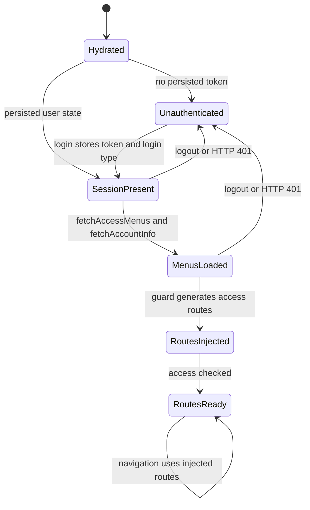
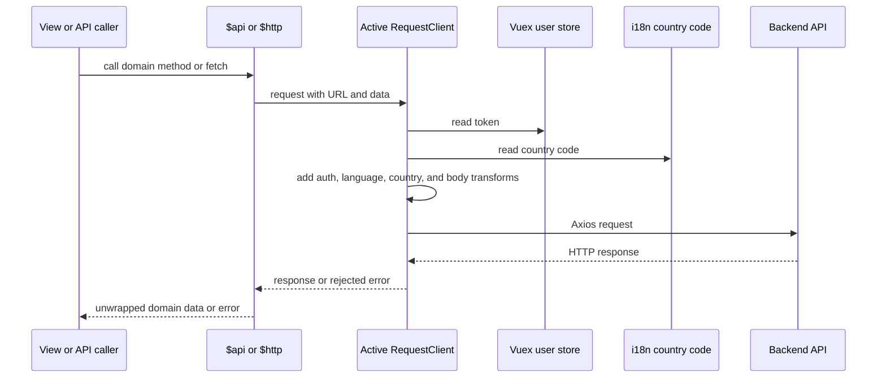

# Runtime Architecture and Access Model

This frontend is a Vue 2 application whose runtime behavior is controlled by four coupled boundaries: bootstrap composition, portal-aware routing, Vuex session/access state, and the shared API client. Feature work that crosses any of these boundaries must preserve their ordering and ownership rules.

## Startup and plugin composition

`src/main.js` imports the legacy language bootstrap and global styles, loads the theme composable, and then dynamically imports `src/bootstrap/index.js`. `bootstrap()` installs the API plugin before mounting the application, followed by Element UI, filters, directives, Finder, discovered components, Vue prototype helpers, clipboard, video-player support, and global Lucide icons. It mounts `App.vue` with the singleton router, store, and i18n instance, and exposes the store as `globalThis.$store`.

This diagram shows the application startup ordering from `main.js` through plugin installation and the root mount.

Bootstrap also installs a document `MutationObserver` that adjusts Element UI form labels when the document is RTL. It processes existing and newly added forms when `dir="rtl"` or `lang="ar-SA"`; Arabic layout behavior is therefore part of the bootstrap contract, not only a component concern.

## Product variant and portal selection

Two independent selectors affect the running application:

- **Build-time product variant:** build tooling uses `PLATFORM` to choose the BBC or B2C `newpc` asset source. This is a delivery concern and does not choose the router’s portal.
- **Runtime portal:** `src/router/routes/index.js` examines the browser URL for `/shopadmin`, `/supplier`, or `/merchant`. It loads that portal’s route directory; URLs without one of those namespaces load the root `modules` routes. The router always starts with core routes and adds the selected dynamic route set as access routes.

The router uses HTML5 history mode and `VUE_APP_PUBLIC_PATH` as its base. A deployment under a public subpath must keep that setting aligned with the generated links and server fallback configuration.

## Authentication and access-controlled navigation

The login flow writes the token, login type, and product/menu mode into Vuex, then dispatches `user/fetchAccessMenus` and `user/fetchAccountInfo`. After those requests complete, it reloads the application root (or the license/login special case), allowing the guard to build the authenticated route table from the persisted menu tree.

The access guard runs on every navigation:

1. Without a token, it permits login/license routes and redirects protected portal paths to the matching `/{portal}/login`; root paths go to `/login`.
2. With a token, core routes bypass dynamic permission generation. For dynamic routes, the first guarded navigation calls `generateAccess()` unless `access.isAccessChecked` is already true.
3. `generateAccess()` converts leaf `alias_name` values in `user.accessMenus` into permission strings, filters the static access route tree by route metadata permissions, adds the resulting routes and a portal-prefixed fallback route, and marks access as checked.
4. An inaccessible target, or a bare `/shopadmin`, `/supplier`, or `/merchant` root, is redirected to the first router route whose metadata contains the first stored permission.
5. The guard also prevents a persisted login type from entering the wrong portal. Root paths require an admin/staff login; `/shopadmin` requires a distributor login. Supplier and merchant namespaces are selected by the route set, but the guard’s explicit mismatch check currently covers only those two conditions.

This diagram shows the guard’s authentication, dynamic route generation, portal, and fallback decisions.

`src/layout/basic/layout.vue` renders its main and submenus from `store.state.user.accessMenus`, so route metadata and the backend menu tree must remain aligned. `src/layout/authentication/auth.vue` is the authentication shell. A change to a route, menu alias, permission metadata, or login namespace should be checked against both the guard and the layout navigation.

## Vuex state and persistence lifecycle

`src/store/index.js` registers `access`, `user`, `system`, `decoration`, and `sku` modules. Vuex persistence uses `vuex-persist` with local storage key `__presist` and persists only the `user` and `system` modules. Consequently, the user token, login type, account/menu data, and system version state can survive a reload; the `access` module does not. Its `isAccessChecked` flag and derived permission list are rebuilt in memory, while the guard regenerates routes from the persisted `user.accessMenus` on the next protected navigation.

The access source is refreshed explicitly by `user/fetchAccessMenus`, which calls `api.auth.getPermission()` and commits the returned menu tree. Logout clears token, account, menu, and login-type state in the user module. The request client’s 401 path also commits `user/logout` and `system/logout` before redirecting, so changes to session cleanup must account for both explicit logout and transport failures.

This lifecycle shows which state survives reload and where menu loading and route injection occur.

## Active API request boundary

`src/api/index.js` discovers the domain API modules and installs two Vue prototype entry points:

- `$api` contains generated domain methods. Each method is wrapped and returns the nested `res.data.data` value expected by callers.
- `$http` is the direct `fetch` helper from `src/api/request/index.js`.

The active `RequestClient` is created with `VUE_APP_BASE_API`, JSON content type defaults, and a 30-second timeout. Its request interceptor:

- adds `Bearer` authorization when the Vuex token exists;
- sets `Accept-Language` from the i18n country code;
- moves GET data into query parameters and removes empty-string parameters;
- converts `isUploadFile` payloads to `FormData`; and
- serializes object bodies when the caller requests `application/x-www-form-urlencoded`.

Before Axios runs, `RequestClient.request()` adds `country_code` from the stored language unless `skipCountryCode` is set. The i18n mapping intentionally distinguishes HTML language from backend country code, for example English uses `htmlLang: en` and `countryCode: en-CN`. Successful HTTP responses without an application `status_code` are accepted; responses with an application status code are rejected for the error interceptor.

This diagram shows the active request boundary and the state reads performed before transport.

For a 401, the active client derives the login path from the current router path, shows an expiration warning, clears user and system modules, and replaces the matching root or portal login after two seconds. The token-refresh queue remains commented out, so the current behavior is logout and redirect, not automatic refresh. Network and timeout errors can show localized messages; individual requests can set `showError: false` to suppress the default error toast.

`src/api/req.js` is a legacy or alternate Axios wrapper with different response unwrapping, timeout, token-expiration, and login-path behavior. Direct callers still exist, so it must not be silently treated as equivalent to the active `src/api/request/` plugin path when changing request behavior.

## Internationalization and RTL effects

`src/i18n/index.js` defines Chinese Simplified, Chinese Traditional, English, Arabic, Japanese, and Russian configurations. It restores the language key from local storage, sets Vue I18n’s locale, and updates the document `lang` and `dir`. `getCurrentCountryCode()` is the shared backend country-code source used by the active request client. New language work therefore requires a locale configuration, message bundle, document-direction check, and request-country-code check. Arabic additionally exercises the bootstrap form-label observer.

## Safe change checklist

- Route changes: identify the build variant and runtime portal, then verify route metadata, `alias_name` values, layout menus, fallback routing, and public-path deployment.
- Authentication changes: verify token/menu persistence, login-type mismatch handling, all portal login redirects, explicit logout, and active-client 401 behavior.
- API changes: use the active `$api`/`$http` boundary unless a legacy caller is intentionally being migrated; preserve GET, upload, form encoding, `country_code`, `Accept-Language`, and `showError` semantics.
- State changes: decide whether data belongs in persisted `user`/`system` state or transient `access` state, and clear it on both explicit logout and transport failure where appropriate.
- Localization changes: update all locale bundles and verify both LTR and Arabic RTL rendering plus backend country-code propagation.
