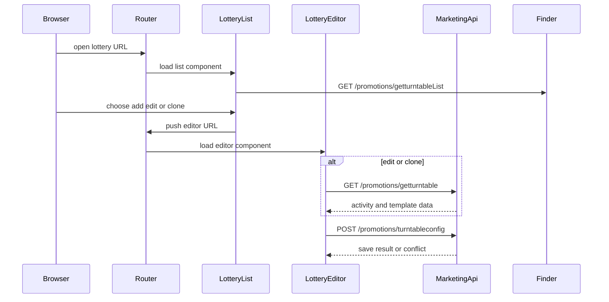
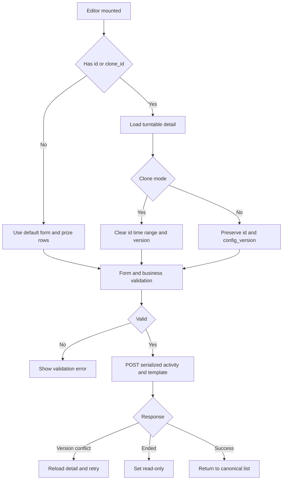

# Lottery Wheel Admin Code Map

This page maps the implementation that owns the lottery-wheel administration workflow. It complements the [API contract](../../api/lottery-wheel-contract.md), [requirements](requirements.md), [source map](../../source-map.md), and [admin workflow](../../workflows/lottery-wheel-admin.md). The current implementation is the Vue 2 marketing module under `src/view/marketing/lottery`.

## Runtime entry and compatibility routes

`/marketing/interactive/lottery` is the canonical administration route. The route module gives it the `lotteryList` name, the `marketing.interactive.lottery` permission, and the list component with the nested `editor/:id?` child. The legacy `/marketing/wheel` and `/marketing/membermarket/wheel` paths are compatibility redirects to the canonical route. The older `src/router/src/route-marketing.js` retains the `/marketing/wheel` redirect as a legacy route definition; the active route tree is `src/router/routes/modules/marketing.js`.

| URL | Owner | Behavior |
|---|---|---|
| `/marketing/interactive/lottery` | `src/router/routes/modules/marketing.js` -> `src/view/marketing/lottery/list.vue` | Canonical list and nested editor entry |
| `/marketing/interactive/lottery/editor` | Same route module -> `editor.vue` | Create |
| `/marketing/interactive/lottery/editor/:id` | Same route module -> `editor.vue` | Edit existing activity |
| `/marketing/interactive/lottery/editor?clone_id=:id` | `list.vue` and `editor.vue` | Draft clone through detail loading, not `copyTurntable` |
| `/marketing/wheel` | `src/router/routes/modules/marketing.js` and legacy route module | Redirects to canonical route |
| `/marketing/membermarket/wheel` | `src/router/routes/modules/marketing.js` | Redirects to canonical route |

This diagram shows the admin entry and save flow; the list and picker both use the Finder list endpoint described below.

## List ownership and operations

`list.vue` owns page state and navigation. It renders an `SpFinder` against `/promotions/getturntableList`, keeps the active status tab in `activeName`, and refreshes the Finder when the route or tab changes. `beforeSearch` removes `status` for the `all` tab; for the other tabs it sends the corresponding `notstart`, `online`, or `expire` value from `constants.js`.

`schema.js` owns the Finder table and statistics dialog schema. The list actions are debounced with a leading call and delegate to the page for edit, stop, clone, and statistics. The stop action is visible only for rows whose `status` is `online`; `list.vue` confirms termination, calls `api.marketing.downLuckyDrawById({ activity_id })`, refreshes, and reports non-cancel errors. Clone navigation is `editor?clone_id=<id>`, so the editor can reuse detail normalization while clearing the activity identity and time range.

The statistics dialog has two separate data paths:

- `getTurntableCountById({ activity_id })` populates the summary totals.
- The embedded `SpFinder` directly calls `promotions/getturntable_log/byid?activity_id=<id>`. Its search hook maps `pageSize` to `page_size`.

The log table displays five fields: user ID, member identifier, prize, prize type, and winning time. The member identifier renderer falls back in order through `user_card_code`, `username`, `member_code`, and `mobile`, then `-`. Export calls `exportLuckyDrawData({ activity_id })` and routes to the shared export-record tab `export_luckdraw_log`.

## Editor lifecycle and state

`editor.vue` owns the mutable form, preview state, modal state, normalization, business validation, payload construction, and save/error handling. `editorSchema.js` owns the field and inline prize-table controls; `constants.js` supplies status maps, prize types, the default prize row, and the default Lucky Wheel template.

### Load, edit, clone

On mount, the editor chooses `id` before `clone_id` as its source. It calls `api.marketing.getTurntableDetail({ id: sourceId })`, then maps the response into the form:

- edit mode preserves the activity ID and `config_version`;
- clone mode appends `副本` to the name, clears the time range and ID, and leaves `config_version` unset;
- coupon and coupon-package values are normalized from `prize_detail` into `{ card_id, title }` or `{ package_id, title }`;
- template values restore background, `gameMarginTop`, prize styling, hot-area settings, rule-button settings, and record-button settings.

An ended activity, including a `LUCKY_DRAW_ENDED` response, switches the editor to read-only. Edit mode permits only the end of the date range to change; the start remains the stored value. Activity cost is set to the points mode and is disabled after creation.

### Validation and save invariants

Before saving, `validateBusiness` requires a future, ordered time range; prevents a daily limit from exceeding a positive total limit; requires cost at least `1`; requires non-empty activity introduction; requires at least one `thanks` prize; and requires the configured probability sum to be greater than `0` and at most `100`. Prize names are required and capped at five characters. Coupon and package daily stock cannot be negative or exceed the selected source quantity. The editor also supplies defaults of `150` for `gameMarginTop` and `20` for hot-area padding when those values are empty.

`submitAfter` sends `activity_name`, `intro`, `activity_type: 'wheel'`, numeric limits and cost, Unix timestamps, serialized `prize_data`, and serialized `activity_template_config` to `api.marketing.editTurntableConfig`. The template preserves the default Lucky Wheel structure and embeds the same prize payload used by the activity data, plus background, button, hot-area, rule, and record configuration. Edit requests add `id` and `config_version`; a `LUCKY_DRAW_CONFIG_VERSION_CONFLICT` reloads the detail and asks the operator to retry. A successful save returns to the canonical list.

This flow captures the editor's create, edit, clone, validation, and failure transitions.

## Schemas, defaults, and visual configuration

`constants.js` defines the status vocabulary (`notstart`, `online`, `expire`), prize types (`thanks`, `points`, `coupon`, `coupons`), a blank prize row, and `defaultGameConfig`. The default template uses a `300px` by `300px` wheel, a `150px` page top margin, a `120px` container margin, and Lucky Wheel block/button defaults. The editor converts the numeric form margin to a pixel string for the saved template.

`editorSchema.js` exposes the main form, prize table, hot-area dialog, rule-button dialog, and record-button dialog. The prize table supports up to eight rows, protects the `thanks` row from deletion and type/name changes, and delegates coupon selection to the shared picker flows. Background reset restores a blank image and `#ffffff`; the rule and record controls have restore-default actions. The commented-out regional field and commented-out winning-image field are currently not active controls.

## Decoration picker integration

`picker-lottery.vue` is registered through `src/components/sp-picker/pickers/index.js`, exposed by `PickerDialog.vue`, and made available as the `lottery` tab in `picker-path.vue`. The picker is the decoration-side caller of the same `/promotions/getturntableList` Finder URL. It searches by `activity_id` or `activity_name`, restores matching selected rows after a search, and updates the picker value from Finder selection changes.

The picker deliberately deletes `status` and `regionauth_id` before searching, so decoration can select activities regardless of lifecycle status or region. Its multiple-selection branch currently leaves `updateVal` commented out; the single-selection branch explicitly clears and reselects the row. The picker plugin maps the `lottery` picker type to `pickerLottery`, while the path selector mounts it only when the lottery tab is selected.

## API boundary and aggregation

The concrete wrappers are in `src/api/marketing.js`:

| Operation | Wrapper | HTTP request |
|---|---|---|
| Detail | `getTurntableDetail` | `GET /promotions/getturntable` |
| Create or update | `editTurntableConfig` | `POST /promotions/turntableconfig` |
| Log detail | `getTurntableLogById` | `GET /promotions/getturntable_log/byid` |
| Summary counts | `getTurntableCountById` | `GET /promotions/getturntable_count/byid` |
| Stop | `downLuckyDrawById` | `GET /promotions/down_lucky_draw/byid` |
| Export | `exportLuckyDrawData` | `GET /promotions/down_lucky_draw/export` |
| Optional server copy | `copyTurntable` | `POST /promotions/turntable/copy` |

The list and picker Finder URLs are direct component configuration rather than wrappers in `marketing.js`. `src/api/index.js` recursively imports API modules and wraps each function to return `res.data.data`, so callers use these functions under `api.marketing`. Finder requests do not pass through those named wrapper functions.

## Evidence-backed risks and maintenance notes

- The stop wrapper uses `GET` for `/promotions/down_lucky_draw/byid`; changing it to `POST` or `PUT` would be an API behavior change and requires contract confirmation.
- The form enforces `cost_value >= 1`, and clone mode also raises a source value below `1` to `1`. This conflicts with any requirement or backend contract that permits free draws; the current frontend does not implement a zero-cost draw.
- The list log schema labels the member field as `member_code` but renders several possible response fields. This is deliberate frontend fallback behavior and indicates that the backend response naming is not stable enough to document as one guaranteed field.
- `copyTurntable` exists as an API wrapper, but the admin list's copy action uses the editor `clone_id` flow instead. Changing the copy path would alter when IDs, timestamps, and `config_version` are cleared.
- The picker has no status filter by design, while the admin list filters status tabs. Consumers should not assume picker results are limited to online activities.
- Rule-button UI and record-button UI are active in the schema, but the separate commented-out regional and winning-image controls are not implemented entrypoints. Documentation and integrations should follow the active schema rather than the commented code.

## Focused verification points

There are no lottery-specific test files in the inspected source paths. The highest-value checks when changing this area are therefore route resolution for all three URLs, list status parameter transformation, clone versus edit detail normalization, payload serialization including `config_version`, ended-activity read-only behavior, conflict reload handling, Finder log pagination/export routing, and picker selection with status fields removed. Representative source locations for these checks are linked throughout this page.
