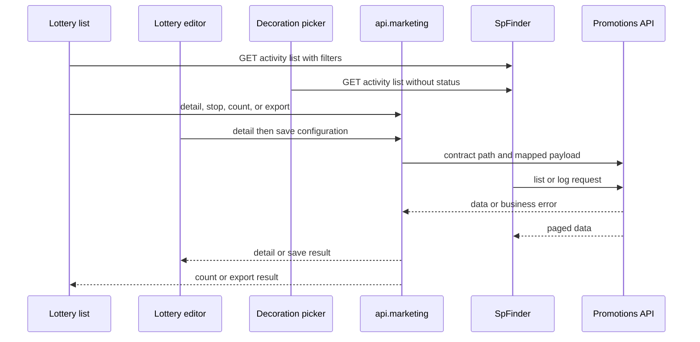
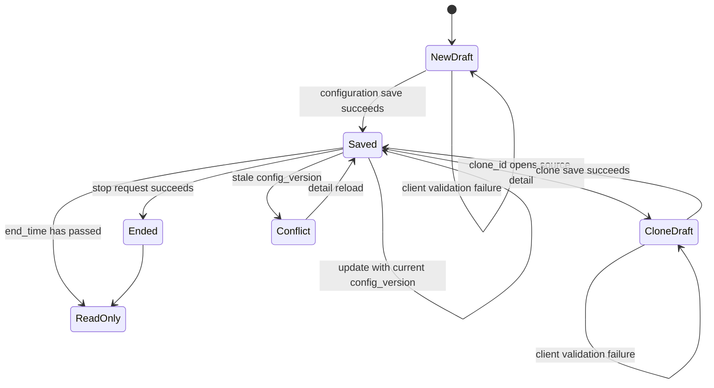

# Lottery Wheel Admin Requirements

## Scope and authority

This page covers the Vue Admin workflows for lottery-wheel configuration and selection:

- activity list and status tabs;
- create, edit, terminal-state handling, and draft copy;
- manual termination;
- statistics, log details, and export;
- decoration mounting through the lottery picker.

Vshop/H5 user-facing behavior is excluded. The API contract in [`openwiki/api/lottery-wheel-contract.md`](../../api/lottery-wheel-contract.md) is authoritative for HTTP methods, paths, request transport, and error codes. Product decisions are recorded only where the requirements/PRD decision is explicit. The legacy `/marketing/wheel` URL remains a compatibility route; the current menu and page workflow use `/marketing/interactive/lottery` and its `/editor` child route (`src/router/routes/modules/marketing.js`).

Common Admin contract assumptions are `activity_type=wheel`, points consumption represented by `cost_type=2`, Unix-second timestamps, and no `area_id` in the lottery configuration payload. The current save implementation does not send `cost_type` or `area_id`; the editor keeps the points control disabled and fixes `activity_type` to `wheel` (`src/view/marketing/lottery/editor.vue`, `src/view/marketing/lottery/editorSchema.js`).

## End-to-end control flow

This shows the two transport entrypoints used by the Admin: named wrappers in `src/api/marketing.js` and direct Finder URLs in the list, picker, and statistics schema.

## Task map and acceptance criteria

### ECX-9936: Activity list

**Entry point:** `src/view/marketing/lottery/list.vue`; table and filters are defined in `src/view/marketing/lottery/schema.js`.

**Required behavior**

- Load `GET /promotions/getturntableList` through `SpFinder`.
- Search by `activity_id` and `activity_name`.
- Provide `all`, `notstart`, `online`, and `expire` tabs. `all` removes `status`; the other tabs send their exact status value.
- Render activity ID, name, type, status, time range, created time, and updated time.
- Route Add to `/marketing/interactive/lottery/editor` and Edit to `/marketing/interactive/lottery/editor/:id`.
- Show Stop only when the row status is `online`.
- Expose Copy and Statistics actions for rows. Action handlers are debounced to prevent repeated activation.

**Acceptance evidence**

The list URL, tab mapping, filters, row actions, and edit/copy/statistics routes are implemented in `src/view/marketing/lottery/list.vue` and `src/view/marketing/lottery/schema.js`. Automated lottery-specific tests are absent; filter-to-request mapping and route behavior are **pending verification**.

### ECX-9935: Create and edit configuration

**Entry point:** `src/view/marketing/lottery/editor.vue`; field and prize controls are in `src/view/marketing/lottery/editorSchema.js`.

**Required behavior**

- Load details with `GET /promotions/getturntable` and save with `POST /promotions/turntableconfig`, using `src/api/marketing.js` wrappers.
- Create sends the activity name, required rich-text `intro`, Unix-second times, limits, serialized `prize_data`, and serialized `activity_template_config`.
- Update sends `id` and `config_version` for optimistic concurrency. The existing begin time and `cost_value` are locked after creation; edit date input only changes the end time.
- Keep `activity_type` fixed to `wheel`; the Admin points control displays disabled `cost_type=2`. `area_id` is not restored or submitted.
- Normalize empty or negative total/daily limits to `0`; a positive daily limit cannot exceed a positive total limit.
- Require an end time after both the begin time and the current time. Require non-empty `intro` after stripping HTML tags.
- Require at least one `thanks` prize, allow no more than eight prize rows, and require total probability in `(0,100]`. A `thanks` row cannot be renamed, changed to another type, or deleted.
- Support prize types `thanks`, `points`, `coupon`, and `coupons`. Coupon and coupon-pack values are mapped to `card_id` and `package_id` respectively, and their daily stock cannot be negative or exceed known available quantity.
- Serialize prize rows with `sort`, `name`, `type`, `value`, `probability`, `backgroundColor`, compatibility `background`, `image`, and coupon daily stock where applicable. Existing `prize_id` values are preserved on normal edits.
- Serialize visual configuration including default top margin `150px`, background image/color, wheel blocks, center button, rule button, record button, and the same normalized prizes under `gameConfig.prizes`. Decoration controls default to padding `20`.

**Acceptance evidence**

The payload and validations are implemented in `src/view/marketing/lottery/editor.vue` and `src/view/marketing/lottery/editorSchema.js`; endpoint mappings are in `src/api/marketing.js`. The current source enforces `cost_value >= 1`, while the existing product decision recorded in the prior requirements brief says `cost_value >= 0` with `0` meaning free. This is an unresolved contract/product mismatch and must be decided before accepting free draws; the documentation does not silently choose a rule. The source also does not perform broad legacy-key dual writes: it emits current prize keys and the `background` compatibility field only. Payload round trips, validation boundaries, and backend acceptance are **pending verification** because no lottery-specific automated tests were found.

### ECX-9937: Manual termination

**Entry point:** Stop in `src/view/marketing/lottery/list.vue`.

**Required behavior**

- Offer a confirmation prompt before termination.
- Call `GET /promotions/down_lucky_draw/byid` with `{ activity_id }` only after confirmation.
- Refresh the list and show success after the request succeeds.
- Show the backend message when available, otherwise a generic failure; ignore cancellation of the confirmation dialog.
- The action must be unavailable for non-`online` rows. A terminated/expired activity must become non-editable through the editor lifecycle.

The wrapper and exact path are in `src/api/marketing.js`; visibility, confirmation, refresh, and error handling are in `src/view/marketing/lottery/list.vue`. Repeat termination and backend terminal-state behavior are **pending verification**.

### Copy: draft clone, not server-side copy

**Entry point:** Copy in `src/view/marketing/lottery/list.vue`, clone initialization in `src/view/marketing/lottery/editor.vue`.

Copy routes to `/marketing/interactive/lottery/editor?clone_id=<id>`. The editor loads the source detail through the normal detail endpoint, appends `副本` to the name, clears the activity ID and `config_version`, clears the date range for a new selection, and saves through `POST /promotions/turntableconfig`. A new activity ID is therefore expected only after a successful save. The optional `POST /promotions/turntable/copy` wrapper exists in `src/api/marketing.js` but is not the Admin primary path.

Clone behavior, including clearing identity/version and preventing accidental mutation of the source, is **pending verification**. The repository has no focused lottery test file.

### ECX-9938: Statistics and export

**Entry point:** Statistics in `src/view/marketing/lottery/list.vue`; dialog table and summary fields in `src/view/marketing/lottery/schema.js`.

**Required behavior**

- Request summary counts with `GET /promotions/getturntable_count/byid` and `{ activity_id }`.
- Display the four summary values returned by the count response: `total`, `totalGet`, `totalGetUser`, and `totalUser`.
- Load details with the direct Finder URL `promotions/getturntable_log/byid?activity_id=<id>`.
- Forward Finder `pageSize` as backend `page_size`.
- Show user ID, member code, prize title, prize type, and creation time. Member code fallback is `user_card_code`, `username`, `member_code`, `mobile`, then `-`.
- Export with `GET /promotions/down_lucky_draw/export` and `{ activity_id }`, then route to the export-record tab `export_luckdraw_log`.

The wrappers and export path are in `src/api/marketing.js`; the statistics UI, log URL, pagination mapping, columns, and fallbacks are in `src/view/marketing/lottery/list.vue` and `src/view/marketing/lottery/schema.js`. The requirements decision that counting includes `SUCCESS` and `GRANT_FAILED`, excludes `thanks` from winning counts, and includes `thanks` in logs is not derivable from the current Admin code and therefore remains **pending contract/backend verification**.

### ECX-9939: Decoration mounting picker

**Entry point:** `src/components/sp-picker/pickers/picker-lottery.vue`.

**Required behavior**

- Use `GET /promotions/getturntableList` through `SpFinder`.
- Search by activity ID or activity name.
- Remove `status` and `regionauth_id` before searching so activities of every lifecycle status, including ended activities, remain selectable.
- Restore selected rows by ID when the picker receives existing values and update the picker value on selection changes.
- Keep the picker scoped to Admin decoration integration; it does not implement user-facing lottery behavior.

The URL, search fields, status removal, selection restoration, and value update are implemented in `src/components/sp-picker/pickers/picker-lottery.vue`. Selection of ended activities and multi-select behavior are **pending verification**.

## Lifecycle, failures, and invariants

The editor makes a detail with an elapsed `end_time` read-only, handles `LUCKY_DRAW_ENDED` by switching to read-only, and handles `LUCKY_DRAW_CONFIG_VERSION_CONFLICT` by showing an error and reloading detail (`src/view/marketing/lottery/editor.vue`). The save path must never retry a stale payload without reloading the current version. Backend validation remains authoritative over UI validation.

The shared request layer supplies transport-level behavior such as authentication, timeout, locale, and HTTP failure handling; those are outside the lottery task map and are documented in the API contract. Lottery-specific error handling currently covers `LUCKY_DRAW_CONFIG_VERSION_CONFLICT`, `LUCKY_DRAW_ENDED`, backend messages, and generic operation failures (`src/view/marketing/lottery/editor.vue`, `src/view/marketing/lottery/list.vue`).

## Focused verification checklist

No lottery-specific automated test or spec files were found under `src`. Before treating this map as fully accepted, verify the following against a test backend or focused UI/API checks:

1. Each list tab and search field produces the exact expected query, including omission of `status` for `all`.
2. Create and edit preserve the detail-to-form-to-payload round trip, Unix timestamps, serialized JSON fields, `config_version`, and immutable begin/cost fields.
3. `cost_value=0` behavior is resolved consistently between product decision, editor validation, and backend contract.
4. Prize probability, `thanks`, row-count, coupon stock, limit, and required `intro` validations match backend rules.
5. Stale-version and ended-activity responses produce the documented reload/read-only behavior.
6. Clone saves as a new activity and cannot overwrite its source.
7. Stop refreshes the list, rejects repeated terminal actions, and surfaces backend errors.
8. Statistics summary, log pagination, member fallback, prize-type rendering, export redirect, and `thanks` counting match backend data.
9. The decoration picker can search and select activities in every lifecycle status, including ended activities.

## Implementation anchors

- `src/router/routes/modules/marketing.js` — current Admin routes and legacy redirect.
- `src/api/marketing.js` — named detail, save, count, stop, export, and optional copy wrappers.
- `src/view/marketing/lottery/list.vue` — list lifecycle, routes, stop, statistics, and export callers.
- `src/view/marketing/lottery/schema.js` — list filters/actions and statistics/log schema.
- `src/view/marketing/lottery/editor.vue` — detail lifecycle, validation, clone, payload serialization, and error handling.
- `src/view/marketing/lottery/editorSchema.js` — form controls, prize constraints, and decoration configuration controls.
- `src/view/marketing/lottery/constants.js` — statuses, prize types, defaults, and template defaults.
- `src/components/sp-picker/pickers/picker-lottery.vue` — unfiltered Admin decoration activity picker.
- `openwiki/api/lottery-wheel-contract.md` — frozen endpoint and transport reference.
