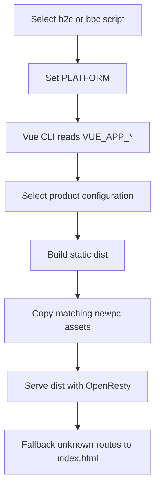

# Build, configuration, and delivery

This runbook describes how the [runtime architecture](../architecture/overview.md) becomes a B2C or BBC static application and how that artifact is served. It documents placeholders and configuration names only; never copy `.env` or `.env.local` values, credentials, access keys, tokens, or other secrets into the wiki.

## Runtime contract and commands

The current repository requires Node **22.23.4** and pnpm **10.13.0**. `.nvmrc`, the `package.json` engines and package manager fields, the README, and the Docker builder image agree on these versions. Enable Corepack so local installs use the declared pnpm version, then install from the lockfile:

```sh
nvm use
corepack enable
pnpm install --frozen-lockfile
```

The two supported platform variants are selected by the scripts in `package.json`:

```sh
pnpm run dev:b2c
pnpm run dev:bbc
pnpm run build:b2c
pnpm run build:bbc
```

Each command sets `PLATFORM` to `b2c` or `bbc` before invoking Vue CLI. `vue.config.js` exposes that value to application code as `VUE_APP_PLATFORM`; `src/config/index.js` then selects the matching `src/config/products/b2c.js` or `src/config/products/bbc.js` configuration. `vue.config.js` also defines a copy routine that would select `newpc_b2c` or `newpc_bbc` and target `dist/newpc`, but the production `CopyWebpackPlugin` registration is currently commented out. Verify the resulting artifact and enable or restore that registration deliberately if the platform-specific microfrontend files are required.

The development server listens on port `8080`, opens the browser, enables hot reload and compression, and enables HTML5 history fallback. The proxy examples in `vue.config.js` are commented out, so API requests must use a reachable configured base URL or a same-origin deployment.



This diagram shows the platform selection, build-time injection, artifact assembly, and static delivery path.

## Build-time configuration

Vue CLI embeds `VUE_APP_*` values into the generated static bundle. Changing an API URL, public path, microfrontend entry, language, website, map, media, delivery, or SaaS/free-mode setting therefore requires a new build; changing the build environment after the image or static files are produced does not update the browser bundle.

The important non-secret configuration names are:

- `VUE_APP_BASE_API` — backend API base. The request client uses it as its `baseURL`; the fallback in the request utilities is `/`. An empty value therefore sends API traffic to the frontend origin and commonly makes login fail unless the frontend host proxies the API.
- `VUE_APP_PUBLIC_PATH` — Vue CLI public path and router base. Keep it consistent with the URL prefix under which the static application is served; it defaults to `/`.
- `VUE_APP_QIANKUN_ENTRY` — qiankun design microapplication entry. The runtime registers it for the `/decoration/web/template/edit` route.
- `VUE_APP_DEFAULT_LANG`, `VUE_APP_IS_SAAS`, `VUE_APP_FREE`, and `VUE_APP_CHUZHI` — product/runtime feature settings consumed by the application.
- `VUE_APP_MAP_KEY`, `VUE_APP_H5_HOST`, `VUE_APP_WEBSITE`, `VUE_APP_WXIMG_URL`, `VUE_APP_WXAUTHCALL_Url`, and `VUE_APP_LOCAL_DELIVERY_DIRVER` — map, storefront, preview, WeChat, and delivery integrations.
- `VUE_APP_OSS_CDN` — enables the Aliyun OSS upload plugin when exactly `true`; the related region, bucket, and credential variables are build inputs and must be supplied only through a protected build system.

Use `.env` or the git-ignored `.env.local` as the local configuration mechanism described by the README, but document only placeholder names and safe example values. Docker `ARG`/`ENV` declarations pass the same build-time inputs into the builder; they do not make those values runtime-editable or safe to print.

## Vue CLI production output

Production mode disables source maps, extracts CSS, minifies JavaScript and CSS, removes console/debugger calls, splits Element UI, other libraries, common modules, and styles into chunks, and emits gzip copies for JavaScript, CSS, HTML, and SVG files larger than 10 KB when compression is worthwhile. Original assets remain alongside the gzip files.

When `VUE_APP_OSS_CDN=true`, `vue.config.js` uploads `dist` assets except HTML and ICO files to the fixed `/ecshopx-admin` OSS path, with `deleteAll: false`. The build configuration logs every environment variable whose name contains `VUE_APP`; protect CI/build logs when any supplied value is sensitive.

## Docker and OpenResty packaging

The main `Dockerfile` is a multi-stage build. Its builder uses `node-python3:22.23.4-alpine3.20`, enables Corepack, activates pnpm `10.13.0`, installs with `pnpm install --frozen-lockfile`, copies the source, and executes the command supplied through `ARG CMD` (for example, a platform build command). The final `openresty:1.19` image copies `/app/dist` into `/app` and exposes port `80`.

`Dockerfile-Atlas` is the alternate packaging path for an already-built `dist`: it uses the same OpenResty `1.19` base, copies `docker/nginx-default.conf` to the virtual-host configuration location, copies the tracked `dist` contents into `/app`, and exposes port `80`. This path does not run the frontend build.

The tracked Nginx configuration serves `/app`, sets `index.html` as the index, and uses `try_files $uri $uri/ /index.html =404` for SPA deep-link fallback. It adds `nosniff` and XSS headers, caches images for 30 days and JavaScript/CSS for one hour, rejects sensitive-looking `ini`, `sql`, `conf`, and `bak` files, and denies selected repository/configuration paths. Verify that the chosen image includes or installs this configuration before relying on these behaviors: `Dockerfile-Atlas` does so explicitly, while the main Dockerfile relies on its OpenResty base image configuration.

## Delivery checks

1. Select exactly one platform and inspect the resulting artifact; because the `newpc` copy plugin is currently disabled, do not assume `dist/newpc` contains the matching `newpc_b2c` or `newpc_bbc` source.
2. Use Node `22.23.4`, pnpm `10.13.0`, and a frozen lockfile install in local, CI, and container builds.
3. Provide non-secret build configuration through the trusted environment, especially `VUE_APP_BASE_API`, `VUE_APP_PUBLIC_PATH`, and `VUE_APP_QIANKUN_ENTRY`; do not put credentials in tracked files or image history.
4. Rebuild after every `VUE_APP_*` change and inspect the generated public paths and API base behavior.
5. Serve the artifact over the intended URL prefix, test login against the configured backend, and request a direct deep link to confirm SPA fallback.
6. If OSS upload is enabled, verify the `/ecshopx-admin` asset location and access policy without exposing credential values.
7. Use the [integration and quality guide](integrations-and-quality.md) for repository checks and automation boundaries.
