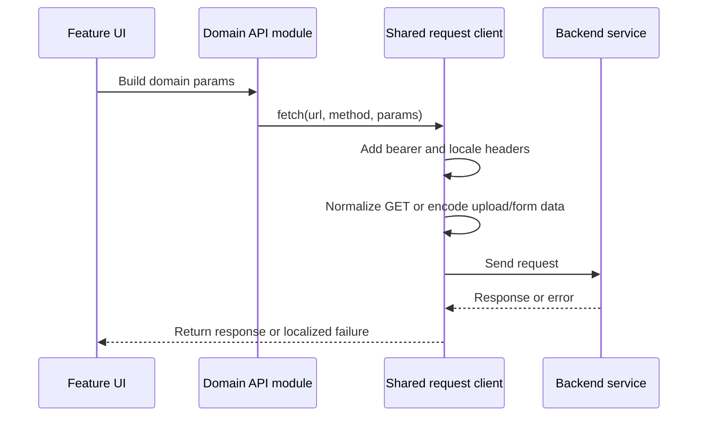

# Integrations, automation, and verification

The application concentrates outbound HTTP behavior in `src/api/request/index.js` and exposes domain functions from `src/api/*.js`. A domain API module owns the endpoint path and HTTP verb; the shared client supplies authentication, locale, serialization, upload, response, and failure behavior. This page records those boundaries and the checks that can be run from the repository.

## Request boundary

This diagram shows the common feature-to-backend request lifecycle.

The request interceptor adds `Authorization: Bearer ...` when the store has a token and always sets `Accept-Language` from `getCurrentCountryCode()`. The locale mapping is deliberately not identical to the HTML language value: English uses HTML `en` but backend country code `en-CN`; Arabic uses `ar-SA` and RTL document direction. A language change updates Vue I18n and document `lang`/`dir`, while subsequent requests read the persisted language selection.

GET requests merge `data` into `params`, remove empty-string parameters, and discard the request body. Non-GET requests marked with `isUploadFile` become `FormData`, leaving the browser to set the multipart content type. Object bodies declared as `application/x-www-form-urlencoded` are serialized with `qs`; callers changing payload shape must verify the resulting network request rather than only the component state.

Successful HTTP responses without an application `status_code` pass through. Network and timeout failures use localized messages unless the individual request sets `showError: false`. A 401 clears user and system session state and schedules a route-aware login redirect: `/shopadmin`, `/supplier`, and `/merchant` requests return to their corresponding login path, while other routes use `/login`. Token refresh code is present but disabled; verification must therefore treat a 401 as logout and redirect behavior, not as an automatic retry contract.

## Integration map

| Boundary | Repository contract | Safe-change focus |
| --- | --- | --- |
| Media storage | `src/api/ossStorage.js`, `src/api/qiniu.js`, provider SDK dependencies, and related upload callers | Preserve the shared `FormData` path, content-type handling, provider error display, and non-secret configuration behavior. Do not document credentials or secret environment values. |
| WeChat and mini-program services | `src/api/wechat.js`, `src/api/wxa.js`, and `src/view/wxapp/` | Check authorization/binding, materials, customer service, and mini-program flows against the affected endpoint and role. |
| Payments and merchant services | `src/api/adapay.js`, `src/api/bspay.js`, and finance/merchant views | Verify merchant onboarding, bank/region lookup, channel configuration, and failed requests with the finance workflow. |
| AI material library | `src/api/aiMaterial.js` and `src/views/ai/` | Verify generation, regeneration, conversations, templates, and asset-library linkage as one user flow. |
| Qiankun microfrontend | `qiankun`, `src/utils/micr-app`, `newpc_b2c/`, and `newpc_bbc/` | Build the correct platform and verify parent/child deployment paths and deep links. |
| Backend localization | `src/i18n/index.js` and `src/api/request/index.js` | Check `Accept-Language`, any endpoint `country_code`, fallback locale, and Arabic RTL behavior. |

## Lottery integration contract

The lottery editor is routed at `/marketing/interactive/lottery` and is permission-gated by `marketing.interactive.lottery`. Its prize editor supports coupon, coupon-package, points, and non-winning entries. Coupon selection calls `$picker.couponV2` with a single selection, active status (`date_status: 2`), and `store_self: false`; the selected record is normalized to `card_id`, title, and an available quantity. Coupon-package selection calls `$picker.couponPackage` with a single selected package and normalizes `package_id`, title, and quantity. Both paths write the normalized selection and `prize_detail` back into the corresponding `prize_data` row.

The picker plugin exposes these modal methods through `$picker`, and the picker components use the following backend endpoints:

- Coupon picker: `/discountcard/list`, with status tabs and search/pagination hooks.
- Coupon-package picker: `/voucher/package/list`, with title filtering and restoration of previously selected package IDs.
- Lottery activity picker: `/promotions/getturntableList`, with optional `activity_id` and `activity_name` filters. It accepts activities regardless of status, restores selected rows by activity `id`, and maps the result to `id` plus `activity_name`.

The promotions API module separately exposes activity list and lifecycle operations under `/promotions/activity/lists`, `/promotions/activity/validNum`, `/promotions/activity/invalid`, `/promotions/activity/create`, and `/promotions/activity/give`. Those functions are distinct from the lottery picker endpoint; changing one endpoint must not be assumed to change the other.

For a lottery change, manually verify the complete path: open the permissioned lottery list and editor, choose an active coupon and confirm its ID/title/quantity are reflected in the prize row, choose a coupon package and confirm package ID/title/quantity, search and select a lottery activity by ID and by name, reopen the picker to confirm selection restoration, and save/reload the editor to confirm normalized `prize_data` persists. Also test the points and non-winning branches, the maximum of eight prizes, the invariant that the `thanks` prize cannot be deleted, and rejection or display of backend errors. Capture the browser network request for each promotions, coupon, and coupon-package endpoint when changing request parameters.

## Available quality controls

- `pnpm run lint` runs `prettier-eslint --write --list-different` for JavaScript and Vue files under `src/`; `pnpm run eslint` runs ESLint with `--fix` for JS/JSX; and `pnpm run prettier` writes Prettier output. These commands mutate files, so inspect the diff afterward.
- `.husky/pre-commit` runs `lint-staged`. JavaScript/JSX files receive ESLint auto-fix and Prettier; Vue, MJS, and SCSS files receive Prettier according to the `lint-staged` manifest in `package.json`.
- `.husky/commit-msg` runs Commitlint. `commitlint.config.js` requires a `[TBID:<alphanumeric>-<number>]` prefix, a lower-case approved conventional type, and a non-empty subject. `pnpm run commit` starts the configured Commitizen flow.
- `pnpm run lint:decoration-contract` runs the decoration schema contract assertion and then exports the decoration schema to the sibling web decoration-engine location. `pnpm run export:decoration-schema` performs only the export step; verify the target workspace exists before relying on it.
- `node scripts/check-template-i18n-save-payload.mjs` is a focused Node assertion for decoration DSL row normalization, default/current-locale saves, header/footer persistence, and request payload handling including `skipCountryCode`. Run it when decoration persistence or locale request behavior changes.
- `pnpm run build:b2c` and `pnpm run build:bbc` are the integrated compile checks. Select the affected platform and then verify its deployed SPA fallback, configured API login, and at least one protected route.

`package.json` declares no general `test`, unit-test, or E2E script and no standard unit/E2E test-runner dependency. The two Node scripts are targeted assertions, not broad application coverage. Linting, schema checks, and builds therefore complement focused manual workflow checks rather than replacing them.

## Documentation automation

`.github/workflows/openwiki-update.yml` runs on manual dispatch and daily at 08:00 UTC. It checks out the repository, installs OpenWiki globally under Node 22, runs `openwiki code --update --print`, and creates or updates an `openwiki/update` pull request containing the OpenWiki-controlled documentation paths and workflow metadata. This workflow is documentation automation; it is not the product build or test pipeline. The workflow references provider and tracing configuration through GitHub Actions secrets, which are intentionally not documented here.

## Verification matrix

| Change | Minimum verification |
| --- | --- |
| Shared request client, API payload, or error behavior | Run the focused payload assertion when applicable; exercise the target flow; inspect locale headers and `country_code`; verify network/timeout handling, `showError: false` behavior, and route-specific 401 redirect. |
| Lottery editor, picker, or promotions integration | Run the relevant build; manually cover promotions activity selection, coupon and coupon-package picker queries, decoration/path selection if used, normalized save/reload, selection restoration, limits, and backend errors. |
| Decoration or localized persistence | Run `node scripts/check-template-i18n-save-payload.mjs`; save and reload in the default and current locale; check English `en-CN`, Arabic RTL, and localized content behavior. |
| Upload or provider integration | Exercise the actual provider-facing UI; inspect multipart/form-urlencoded request content; verify success, provider failure, user-facing error, and non-secret configuration availability. |
| Routes, login, or permissions | Run the affected B2C/BBC build; test the target portal, a mismatched-role redirect, a permission-restricted route, and 401 logout/login routing. |
| Decoration schema or component contract | Run `pnpm run lint:decoration-contract`; review generated schema changes and exercise the affected component in the decoration editor. |
