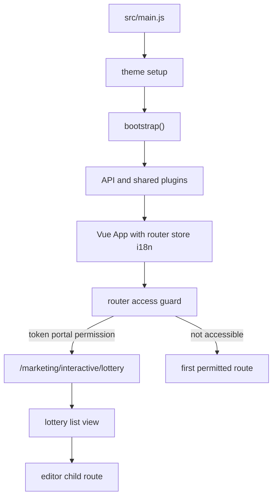
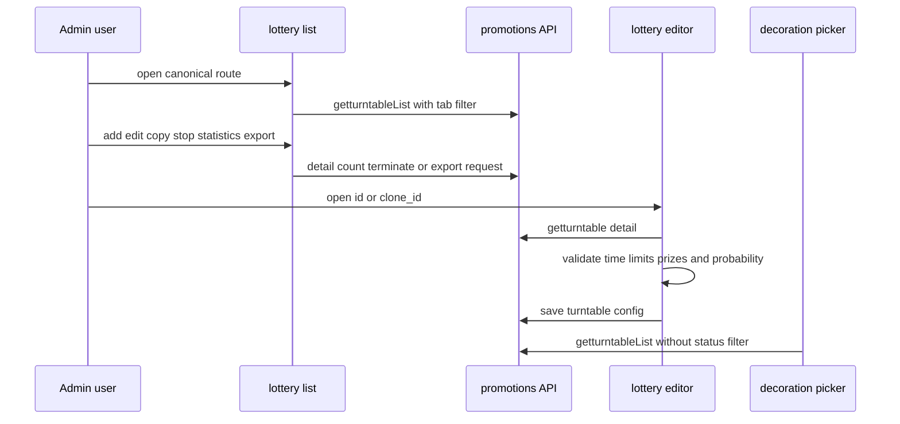

# ecshopx-admin OpenWiki

This is the task-routing entry point for the Admin frontend. The current brief prioritizes the Admin lottery workflow and its promotions contract; Vshop or H5 implementation details are out of scope.

## Start here

| Task | Read next | Primary source evidence |
| --- | --- | --- |
| Understand startup, plugins, API exposure, or access control | [Runtime Architecture and Access Model](architecture/overview.md) | `src/main.js`, `src/bootstrap/index.js`, `src/router/guard.js` |
| Change lottery list, tabs, termination, copy, statistics, or export | [Lottery Wheel Admin Workflow](workflows/lottery-wheel-admin.md) and [Lottery Wheel Admin Requirements](marketing/lottery/requirements.md) | `src/view/marketing/lottery/list.vue` |
| Change lottery editor validation, payload, versioning, or read-only behavior | [Lottery Wheel Admin Code Map](marketing/lottery/code-map.md) and [Lottery Wheel Admin and API Contract](api/lottery-wheel-contract.md) | `src/view/marketing/lottery/editor.vue`, `src/api/marketing.js` |
| Add or change a promotions endpoint wrapper or field mapping | [Lottery Wheel Admin and API Contract](api/lottery-wheel-contract.md) | `src/api/marketing.js` |
| Mount lottery activity selection in decoration or another form | [Lottery Wheel Admin Workflow](workflows/lottery-wheel-admin.md) | `src/components/sp-picker/pickers/picker-lottery.vue` |
| Trace marketing, decoration, or commerce ownership | [Commerce Administration Domains](workflows/commerce-admin.md) and [ECShopX Admin Source Map](source-map.md) | `src/router/routes/modules/marketing.js`, `src/view/`, `src/api/` |
| Build, configure, package, or deliver the Admin bundle | [Build, Configuration, and Delivery](operations/build-and-delivery.md) | `README.md`, `package.json` |
| Choose checks and assess missing focused coverage | [Integrations, Automation, and Verification](operations/integrations-and-quality.md) | `package.json`, `scripts/check-decoration-contract.mjs` |
| Make a cross-cutting feature or bug fix | [Feature and Fix Change Guide](workflows/change-guide.md) | Route, view, API, i18n, and focused validation |

## Runtime route

`src/main.js` imports global styles and i18n, loads `bootstrap` asynchronously, and applies theme setup before initialization. `src/bootstrap/index.js` installs the API, Element UI, Finder, shared components, directives, filters, Vue prototype helpers, clipboard/video plugins, and then mounts `App` with the router, store, and i18n. The router uses history mode and `VUE_APP_PUBLIC_PATH` as its base. The access guard requires a token for protected pages, checks the portal context, generates accessible routes from permissions, and redirects inaccessible destinations to the first permitted route.



This diagram shows the startup and access-control path into the lottery Admin route.

## Lottery route and lifecycle

The canonical Admin route is `/marketing/interactive/lottery`, protected by `marketing.interactive.lottery` and backed by `src/view/marketing/lottery/list.vue`; its optional child route is `editor/:id?`. `/marketing/wheel` and `/marketing/membermarket/wheel` are compatibility redirects to the canonical route. Preserve these redirects when changing route ownership or menu integration.

The list uses `SpFinder` with `/promotions/getturntableList`, translates the active audit tab into a status filter, and exposes add, edit, terminate, copy, statistics, and export actions. Copy is an editor draft flow using `clone_id`; it is not the direct `copyTurntable` API path. The editor loads an existing or cloned activity, normalizes prize data, validates business invariants, serializes `prize_data` and `activity_template_config`, then calls `editTurntableConfig`. Existing activities preserve `config_version`; an ended activity is read-only, and a version conflict reloads the detail.



This sequence summarizes the Admin lifecycle and the shared list boundary used by decoration selection.

## API and decoration boundary

`src/api/index.js` discovers API modules and wraps each function so callers receive `res.data.data`; feature code therefore calls `api.marketing.*`. The lottery wrappers currently cover detail, save, log, count, termination, export, and an optional direct copy endpoint. Verify endpoint methods and response/error semantics against [Lottery Wheel Admin and API Contract](api/lottery-wheel-contract.md) before changing them.

`picker-lottery.vue` extends the shared picker and queries `/promotions/getturntableList`. It filters by activity ID/name, deliberately removes `status` and `regionauth_id`, restores selected rows after search, and emits selection through the base picker value contract. This is the Admin decoration integration boundary; do not document or implement the Vshop consumer page here. The repository's decoration schema contract can be checked with `pnpm run lint:decoration-contract`.

## Build and verification quick reference

Use Node `22.23.4`, Corepack, and the declared `pnpm@10.13.0`; install with `pnpm install --frozen-lockfile`. Development and build targets are:

```shell
pnpm run dev:b2c
pnpm run dev:bbc
pnpm run build:b2c
pnpm run build:bbc
```

`VUE_APP_*` values are build-time inputs. In particular, `VUE_APP_BASE_API` must point to the backend for deployed login/API traffic, and changing it requires a rebuild. Do not put credentials, JWTs, or secret environment values in this wiki.

There are no repository files matching the focused `*.test.*` or `*.spec.*` patterns at the time of this update. For a lottery change, use focused source review plus the applicable build and lint checks, then run `pnpm run lint:decoration-contract` when decoration schema or picker integration is affected. Treat unsupported contract, backend, deployment, and test claims as pending verification and use the linked domain pages for the detailed evidence map.

## Related domains

- [Lottery Wheel Admin Workflow](workflows/lottery-wheel-admin.md)
- [Lottery Wheel Admin and API Contract](api/lottery-wheel-contract.md)
- [Runtime Architecture and Access Model](architecture/overview.md)
- [Build, Configuration, and Delivery](operations/build-and-delivery.md)
- [Integrations, Automation, and Verification](operations/integrations-and-quality.md)
- [Feature and Fix Change Guide](workflows/change-guide.md)
- [ECShopX Admin Source Map](source-map.md)
