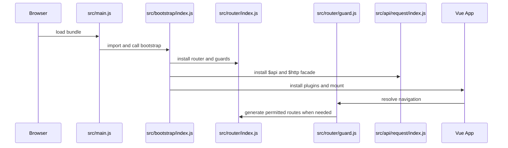

# ECShopX Admin Source Map

Use this page to find the implementation boundary behind a feature or operational concern. It complements [runtime architecture](architecture/overview.md), [build and delivery](operations/build-and-delivery.md), the [quickstart](quickstart.md), and the [change guide](workflows/change-guide.md). This is an ownership map, not an exhaustive file inventory.

## Runtime Entry And Shell

`src/main.js` is the browser entrypoint. It loads the locale and global style layers, asynchronously loads `src/bootstrap/index.js`, and applies the theme color before invoking `bootstrap()`. The bootstrap installs the API facade, Element UI with the active locale, filters, directives, Finder and shared components, Vue prototype helpers, clipboard/video support, and Lucide icons; it then mounts `App.vue` with the router, Vuex store, and Vue I18n instance.

This diagram shows the startup and authenticated navigation boundary; request interceptors and feature components are detailed below.

## Routing And Access Ownership

- `src/router/index.js` creates a history-mode Vue Router using `VUE_APP_PUBLIC_PATH` as its base and installs the guard.
- `src/router/routes/index.js` keeps core routes separate from portal-specific dynamic modules. The selected module set depends on the current `/shopadmin`, `/supplier`, or `/merchant` path; otherwise the standard `src/router/routes/modules/` set is loaded.
- `src/router/guard.js` owns progress/loading cleanup, login redirects, portal-role checks, permission-route generation, and fallback navigation. A tokenless user may reach login/license routes; other destinations redirect to the appropriate portal login. Once menus are loaded, routes are generated from leaf `alias_name` permissions and registered with the router.
- `src/router/access.js` owns the menu-to-route filtering algorithm. It derives dotted permissions from menu trees, retains route nodes whose `meta.permissions` match, adds the generated routes, and registers the not-found route.
- Route/import evidence determines ownership across `src/view/` and `src/views/`. Do not infer the active implementation from folder age or naming: inspect the importing route module and its component import. The legacy tree is still the implementation for many commerce and marketing screens, while the parallel tree is active for core authentication, dashboards, decoration, AI, settings, and selected domain screens.

For a screen change, begin at the route module, follow its lazy import to the owning component tree, then follow that component's API and shared-component dependencies. Portal-specific route copies can coexist with module routes, so check the active base path before changing a duplicate-looking route.

## API And Request Boundary

`src/api/index.js` recursively imports API modules and wraps each exported function so feature code receives `res.data.data`; it installs the resulting domain-keyed object as `Vue.prototype.$api` and exposes `$http` through the shared `fetch`. Domain ownership lives in modules such as `src/api/marketing.js`, `src/api/goods.js`, `src/api/order.js`, `src/api/member.js`, and the nested API directories, rather than in view components.

`src/api/request/request.js` is the low-level Axios client. It supplies a 30-second default timeout, injects `country_code` unless explicitly skipped, and unwraps transport failures to response data. `src/api/request/index.js` adds the application policy: bearer authorization, `Accept-Language`, GET parameter normalization, upload and form encoding, status validation, network/timeout messages, and a delayed single-login redirect for HTTP 401. Preserve these cross-cutting behaviors when adding an endpoint; a local wrapper should normally only define URL, method, and domain parameters.

## The Two View Trees

`src/view/` is the established operational tree. It contains the layout and broad commerce areas, including catalog, orders, members, marketing, finance, merchant/supplier, content, and decoration. `src/views/` is a parallel tree used by explicit route imports for newer or migrated surfaces, including `core`, `dashboard`, `decoration`, `ai`, `products`, `orders`, `members`, `finance`, `settings`, and `applications`.

The safe extension rule is route-first: add or modify the component in the tree imported by the route that users actually enter. Shared behavior belongs in `src/components/`, `src/composables/`, `src/directives/`, `src/filters/`, or `src/utils/` only when the dependency is genuinely cross-domain. `src/layout/`, `src/App.vue`, and the shared `Sp*` components form the presentation shell; they should not absorb feature-specific API or workflow state.

## Lottery Administration

The canonical lottery route is `/marketing/interactive/lottery`, named `lotteryList`, and imports `src/view/marketing/lottery/list.vue`. Its child route is `editor/:id?`, which imports `editor.vue`. Compatibility aliases remain in the route graph: `/marketing/membermarket/wheel` and `/marketing/wheel` redirect to the canonical route, and the older application route under `src/router/src/route-applications.js` also imports the same lottery list/editor implementation. A legacy `src/router/src/route-marketing.js` wheel entry redirects to the canonical URL as well.

The list screen owns activity discovery and operational actions. `SpFinder` queries `/promotions/getturntableList`; tabs map `all`, `notstart`, `online`, and `expire` to the request status filter. The screen loads region authorization data, routes add/edit/clone operations to the canonical editor path, calls `marketing.downLuckyDrawById` to terminate an activity, calls `getTurntableCountById` for statistics, and calls `exportLuckyDrawData` before navigating to the export-record view.

The editor owns create, edit, clone, preview, and read-only state. It loads detail through `marketing.getTurntableDetail`, distinguishes `:id` edit mode from `clone_id` clone mode, normalizes persisted prize data, and makes ended activities read-only. Submission first runs `SpForm` validation and business validation, then serializes prize data and the wheel template through `marketing.editTurntableConfig`. Important invariants include an end time after the start and current time, daily limit not exceeding total limit when total is set, cost at least one, non-empty activity text, at least one `thanks` prize, total probability greater than zero and at most 100, bounded prize names, and non-negative coupon inventory that does not exceed available coupon stock.

The preview is rendered by `src/components/LuckyWheel/index.vue` from the editor's prize, background, margin, hot-area, rule, record, intro, and cost state. Coupon and coupon-package selection uses the shared picker bridge (`$picker.couponV2` and `$picker.couponPackage`), so changes to prize selection should consider picker lifecycle and returned value shape as well as the editor payload contract.

The lottery API boundary is concentrated in `src/api/marketing.js`: detail (`/promotions/getturntable`), save (`/promotions/turntableconfig`), statistics (`/promotions/getturntable_count/byid`), termination (`/promotions/down_lucky_draw/byid`), export (`/promotions/down_lucky_draw/export`), and log endpoints are defined there. Keep endpoint changes in this module and preserve the editor's normalization/serialization contract.

## Shared Pickers And Components

`src/components/sp-picker/plugin.js` creates the `$picker` methods. Each method mounts a picker dialog, waits for its `input` event, resolves the selected value, and destroys the temporary Vue instance; cancellation emits close without resolving a selection. `src/components/sp-picker/main.vue` resolves the picker type, controls dialog visibility, and calls the picker’s `getVal()` on confirmation. Picker registrations and implementations live in `src/components/sp-picker/pickers/`, including `picker-lottery`, which itself queries the same turntable list endpoint and synchronizes selected rows.

Use the picker bridge for reusable selection workflows rather than importing a picker directly into a domain screen. A picker change can affect every caller, so verify its value shape and selection lifecycle against both the picker and at least one caller.

## Localization

`src/i18n/index.js` is the single language configuration source. It maps storage keys to Vue I18n locales, HTML language/direction, country codes, and locale JSON under `src/i18n/locales/`. `changeLang()` updates Vue I18n and document attributes; `getCurrentCountryCode()` is reused by the request layer for both request data and `Accept-Language`. RTL form handling is installed in bootstrap through a `MutationObserver`, so locale changes can affect layout behavior as well as strings.

When adding a translation key, update the locale files consistently and use the repository's translation workflow described in [change guide](workflows/change-guide.md). `build/update_i18n_from_excel.js` is the import utility; do not put credentials or environment secrets in source maps or locale documentation.

## Build, Configuration, And Delivery

- `package.json` defines `dev:bbc`, `dev:b2c`, `build:bbc`, and `build:b2c`; these set `PLATFORM`, which is also exposed as `VUE_APP_PLATFORM` by `vue.config.js`.
- `vue.config.js` owns the `@`/asset aliases, public path, Sass globals, development filesystem cache, production minification and split chunks, asset handling, and optional Aliyun OSS upload. The `PLATFORM` value selects the copied `newpc_bbc` or `newpc_b2c` microfrontend asset set when that copy configuration is enabled.
- `Dockerfile` installs the locked pnpm toolchain in a builder stage, runs the supplied build command, and copies `dist` into an OpenResty runtime image on port 80. Runtime deployment details belong in [build and delivery](operations/build-and-delivery.md).

Configuration may reference environment variables such as `VUE_APP_BASE_API`, `VUE_APP_PUBLIC_PATH`, `VUE_APP_QIANKUN_ENTRY`, and locale/platform settings. Treat access keys and other secret values as deployment inputs; this map records configuration ownership without reproducing them.

## Focused Quality Automation

The repository has focused contract checks rather than a broad unit-test suite. `scripts/check-decoration-contract.mjs` validates decoration section/block schemas, aliases, enum defaults, and default output. `scripts/check-template-i18n-save-payload.mjs` exercises decoration API persistence, DSL parsing/serialization, country-code behavior, and request-client mechanics with controlled fixtures. `scripts/export-decoration-schema.mjs` exports the decoration schema used by the contract workflow. The package script `lint:decoration-contract` runs the contract check and schema export; formatting and ESLint commands cover `src` changes.

`.github/workflows/openwiki-update.yml` runs the OpenWiki update on demand or daily and creates a pull request containing wiki/control-file changes. For a lottery change, use route/import tracing and the editor/list/API invariants above as the focused verification surface, then run the relevant repository lint or build command; there is no lottery-specific test script documented by the current package configuration.

## Fast Paths

- **Wrong screen or duplicate implementation:** inspect the active portal route module and its lazy import first; route/import evidence decides between `src/view/` and `src/views/`.
- **Lottery activity:** use `/marketing/interactive/lottery` and `src/view/marketing/lottery/`; treat `membermarket/wheel` and `wheel` as compatibility redirects.
- **Request/auth/locale issue:** trace `src/api/request/index.js`, `src/api/request/request.js`, `src/i18n/index.js`, and the domain API module together.
- **Menu or access issue:** inspect `src/router/guard.js`, `src/router/access.js`, the portal-specific route module, and persisted user/access state.
- **Build or deployment mismatch:** trace `PLATFORM`, `VUE_APP_PUBLIC_PATH`, and `VUE_APP_BASE_API` through `package.json`, `vue.config.js`, and `Dockerfile`, then consult [build and delivery](operations/build-and-delivery.md).
