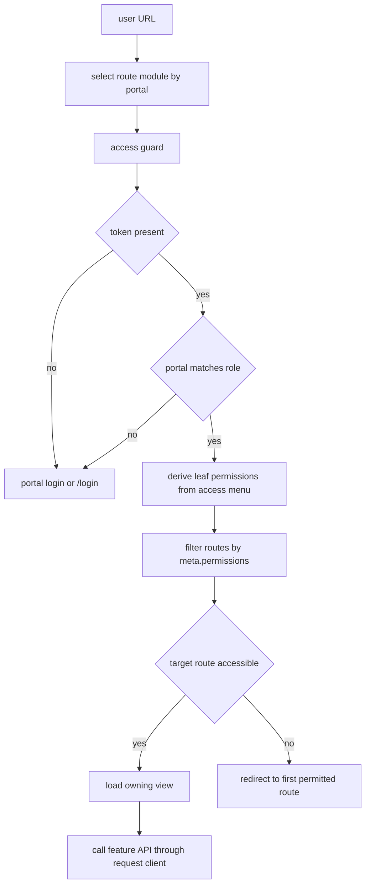
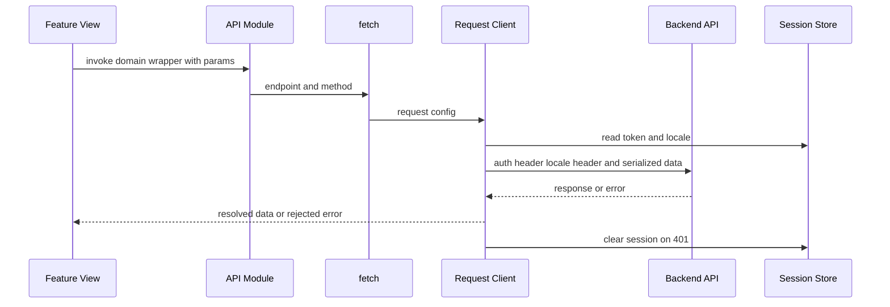
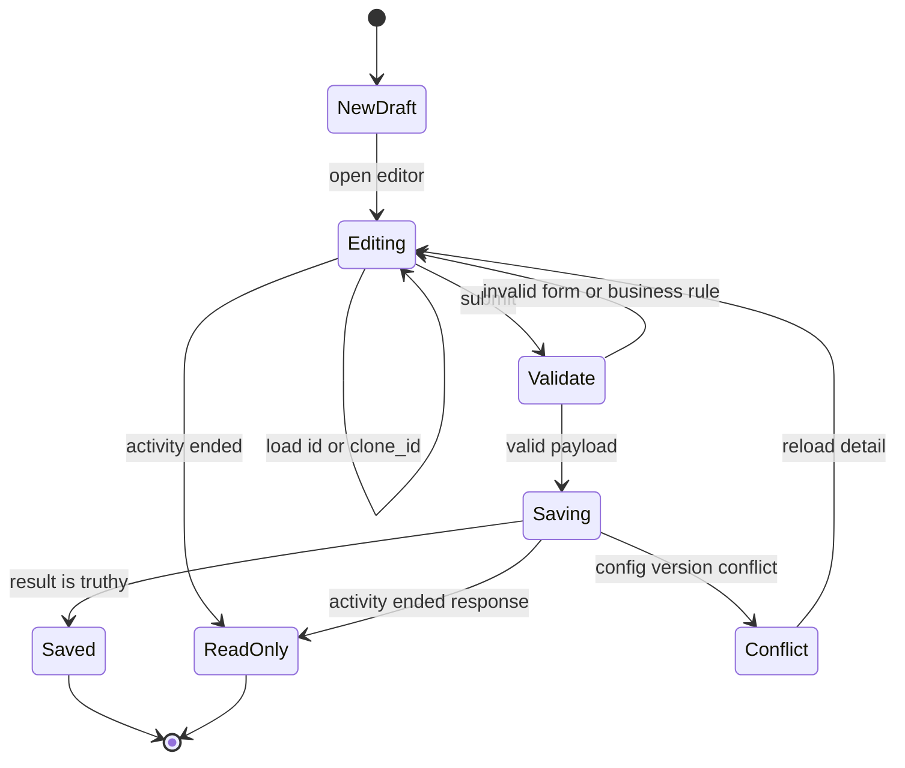

# Feature and fix change guide

Use this playbook after identifying the owning domain in [commerce admin domains](commerce-admin.md) and before editing a screen, route, request, or locale. It is the change procedure for the Vue 2 admin, where route ownership, portal access, API conventions, and client-side business rules are coupled.

## 1. Establish ownership and access

Start from the user-visible URL, then follow the route rather than guessing from a directory name.

1. Search `src/router/routes/` for the path, route name, alias, and `meta.permissions`. `src/router/routes/index.js` selects either a portal-specific directory (`shopadmin`, `supplier`, or `merchant`) or the shared `modules` directory from the current URL base path; the selected route modules become `accessRoutes`.
2. Follow the route component import into `src/view/` or `src/views/`. Both trees are active. Read child routes too, because an editor/detail page may be owned by the list view's route.
3. Find the API module imported by the view, then follow each API wrapper to its endpoint and HTTP method. Inspect the request payload at the caller, not only the wrapper.
4. Check shared components, schema factories, composables, store state, and picker contracts before adding a parallel implementation.

The access guard first allows login/license and core routes, then checks the current portal against the logged-in role. For dynamic routes it calls `generateAccess`: menu leaf `alias_name` values become permission strings, routes are filtered by `meta.permissions`, and the permitted routes are added to the router. An inaccessible target, including a portal root, is redirected to the first route matching the first available permission.

Caption: Route selection, portal/role checks, permission filtering, and feature entrypoint resolution.

When changing a route, preserve all of the following unless the access model is intentionally changing:

- portal prefixes and the role check for `shopadmin`, `supplier`, and `merchant`;
- `meta.permissions` and the menu `aliasName` relationship;
- child paths and optional parameters used by list-to-editor navigation;
- compatibility redirects or aliases used by existing bookmarks and backend menu URLs;
- core-route and fallback-not-found behavior.

## 2. Use the active request conventions

Feature modules normally call `fetch` or the exported `requestClient` from `src/api/request/index.js`. `fetch` maps `params` to request `data`; the request client then adds the current locale's `country_code` unless `skipCountryCode` is explicitly used. The request interceptor adds the bearer token and `Accept-Language`, moves GET data into query parameters while dropping empty strings, converts upload payloads marked `isUploadFile` to `FormData`, and serializes declared `application/x-www-form-urlencoded` objects.

The response layer treats successful HTTP responses without an application `status_code` as successful and rejects application-level failures. Network and timeout errors receive localized messages. A 401 clears user and system session state and redirects once to the login path derived from the current portal; it does not currently refresh the token because the refresh queue is commented out. Keep request-specific `showError: false` behavior when the caller owns its error message.

Caption: Normal feature request flow and the request client's cross-cutting responsibilities.

For request changes, verify method, endpoint, query/body shape, pagination names, upload handling, selection scope, and whether the backend expects the automatically added `country_code`. Do not hand-roll an axios call without evidence that the caller belongs to a different integration boundary.

## 3. Keep i18n synchronized

The single language configuration in `src/i18n/index.js` loads `zh-CN`, `zh-TW`, English, Arabic, Japanese, and Russian messages. It persists the selected language through `localStorage`, sets HTML `lang` and `dir`, and derives the API `country_code` and request `Accept-Language` from the selected language. Arabic is RTL; form changes need an RTL check.

For new or changed user-facing text:

- use the component's existing `$t` pattern and semantic key family;
- add the key to the repository-required `src/i18n/locales/zh-CN.json`, `en.json`, and `ar.json` files;
- assess `zh-TW.json`, `ja.json`, and `ru.json` too because they are configured runtime locales;
- check labels, validation messages, dialogs, empty/error states, picker controls, and JSX/schema-generated text, not just the template;
- avoid treating a missing translation as harmless: `silentTranslationWarn` suppresses warnings while the UI can still render an untranslated key.

`AGENTS.md` requires small scoped changes, existing request-client conventions, and synchronized locale handling. The repository's naming guidance uses lower-case dotted keys and prefixes such as `common.*`, `form.*`, `message.*`, `error.*`, and component-local names.

## 4. Lottery change procedure

Lottery management is a representative high-risk flow. Its current canonical route is `/marketing/interactive/lottery`, with permission `marketing.interactive.lottery`, list view `src/view/marketing/lottery/list.vue`, and editor child path `editor/:id?`. Keep the compatibility redirects from `/marketing/membermarket/wheel` and `/marketing/wheel`. A legacy `/applications/marketing/lottery` route also imports the same list/editor pair, so search both route trees before removing or relocating the feature.

The list owns:

- `GET /promotions/getturntableList` through `SpFinder`;
- status tabs translated to `notstart`, `online`, and `expire`, with `all` removing `status` from the query;
- create, edit, clone, stop, statistics, and export actions;
- `GET /promotions/getturntable`, `/promotions/down_lucky_draw/byid`, `/promotions/getturntable_count/byid`, and `/promotions/down_lucky_draw/export` via `src/api/marketing.js`;
- export navigation through `getExportListPathWithTab('export_luckdraw_log')`, which chooses the correct portal-specific export page.

The editor loads an existing activity for `:id`, or loads one for `clone_id` and clears identity/time fields needed for a new draft. Detail data is normalized to the current prize contract, including coupon `card_id`, coupon-package `package_id`, `prize_detail`, style fields, and `config_version`. Ended activities become read-only; server errors `LUCKY_DRAW_ENDED` and `LUCKY_DRAW_CONFIG_VERSION_CONFLICT` must remain distinct. On an edit, submit the loaded `config_version`; on conflict, reload rather than silently overwriting another operator's update.

The save path is `POST /promotions/turntableconfig`. It serializes `prize_data` and `activity_template_config`, including wheel style, background, hot-area image/padding, button image/style, rule configuration, and record configuration. Keep `prize_data` and the template's `gameConfig.prizes` sourced consistently because the editor and C-side decoration/preview use both representations.

Before changing validation or payload construction, preserve these business rules:

- start and end times are required; end must be after start and in the future;
- positive total limits constrain the daily limit, so `limit_day` cannot exceed `limit_total`;
- cost must be at least 1 and the activity description must contain non-HTML text;
- at least one named `thanks` prize is required, total configured probability must be greater than 0 and no more than 100, and a prize name is at most five characters;
- coupon and coupon-package daily stock cannot be negative or exceed the selected prize's available quantity;
- the thanks prize cannot be deleted or have its name/type changed, and the editor caps the prize list at eight items;
- editing preserves the original start time and only permits the intended end-time change; cloning resets the clone-specific identity/config version state;
- blank `gameMarginTop` and hot-area padding receive the established defaults before save.

Caption: Lottery editor lifecycle, including read-only ended activities and optimistic-version conflicts.

### Decoration and picker boundary

The editor's hot-area and button settings are decoration-like state, but they are local lottery configuration, not a generic route concern. Preserve numeric padding and margin normalization when reading values such as `20px`, and preserve the preview payload shape when changing style controls.

The generic picker plugin exposes `$picker.lottery(args)` as `pickerLottery`. `PickerLottery` uses `/promotions/getturntableList`, accepts the standard `{ type, data, queryParams, params, multiple }` value contract from `BasePicker`, restores selections after search, and deliberately removes `status` and `regionauth_id` so callers can choose any lottery activity. A picker change must retain `updateVal` output shape and single/multiple-selection behavior; do not add a status filter merely because the management list has status tabs.

## 5. Validate proportionally

Use the narrowest checks that cover the changed boundary, then manually exercise the affected role and state. The repository has no general unit test command and no general E2E test command; document that gap rather than implying that `pnpm test` exists.

- For route or permission changes, exercise the intended portal with an authorized role, an unauthorized menu, a missing token, a portal mismatch, a compatibility URL, and the fallback redirect.
- For API changes, inspect the browser request for auth, `Accept-Language`, `country_code`, query/body encoding, pagination, and upload shape; check application errors, network/timeout messaging, and 401 redirection.
- For lottery changes, test list tabs and refresh, create/edit/clone, ended read-only state, optimistic conflict reload, prize validation, coupon stock limits, preview/decorations, stop, statistics pagination, picker selection, and export navigation.
- Run `pnpm run lint` for changed source files when appropriate; the script writes formatting changes, so review its diff. Husky pre-commit runs `lint-staged`, which applies ESLint/Prettier to staged JavaScript/Vue files.
- Run `pnpm run build:b2c` or `pnpm run build:bbc` when shared runtime, environment handling, route loading, product configuration, or bundled assets are affected. The repository requires Node `22.23.4` and pnpm `10.13.0` through the declared engine and package manager settings.
- For decoration DSL/i18n persistence, run `node scripts/check-template-i18n-save-payload.mjs`; it checks payload shape, default-locale save behavior, and request `country_code` handling. This is a focused script, not a general test suite.

## 6. Keep release context visible

Use targeted `git log` and diffs around the owning route, view, API module, and locale keys when a special case is unclear. Release changes update `package.json`, `pnpm-lock.yaml`, and `CHANGELOG.md`; do not mix release metadata into a feature fix unless the task requires it. Keep the final diff small enough that route/access, payload, i18n, and validation decisions can be reviewed independently.
