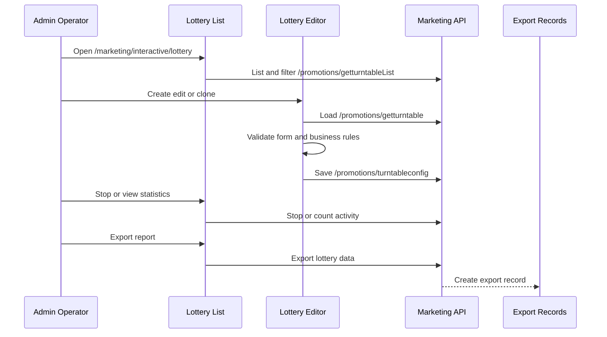

# Commerce administration domains

ECShopX Admin is organized by operational domain, but ownership is not determined by directory name alone. The route modules are the source of truth for active entrypoints: many established Admin workflows import from `src/view/`, while selected newer workflows import from `src/views/`. The two trees can coexist in one domain, and the route import determines which implementation is live. Shared request handling and permission generation remain part of the runtime architecture described in [runtime architecture](../architecture/overview.md).

## Domain map and tree ownership

| Owned system | Representative Admin entrypoints | Runtime responsibility |
| --- | --- | --- |
| Catalog, stores, and supply | `src/view/goods/`, `src/view/mall/`, `src/view/merchant/`, `src/view/dealer/`, `src/view/shop/` | Product/specification/SKU editing, merchant and supplier administration, shop and distributor operations. |
| Orders, delivery, and after-sales | `src/view/order/`, `src/views/orders/`, `src/view/crossborder/` | Order operations, fulfilment/logistics, rights and after-sales, and cross-border workflows. |
| Members and loyalty | `src/view/member/`, `src/views/members/` | Customer/group administration, cards and coupons, points, purchase behavior, UGC, registration, and privacy settings. |
| Marketing and promotions | `src/view/member/promotions/`, `src/view/marketing/`, `src/views/marketing/`, `src/view/popularize/` | Campaign configuration, coupon distribution, member/fission marketing, lottery, recommendation, and distribution operations. |
| PC storefront decoration | `src/views/decoration/` plus the legacy mobile decoration entrypoints in `src/view/decorate/` | PC template metadata, page DSL editing, header/footer content, web navigation menus, login-page assets, and SEO metadata. |
| Finance, payments, and platform configuration | `src/view/financial/`, `src/views/finance/`, `src/view/base/`, `src/view/core/`, `src/view/applications/`, `src/view/regionauth/` | Settlement, invoices, deposits, payment onboarding, system/application configuration, and regional permissions. |

The marketing route demonstrates why imports must be checked feature by feature. Coupon and most promotion routes load `src/view/member/...`, while auto marketing loads `src/views/marketing/autoMarketing`, product recommendation loads `src/views/products/recommend-rules`, and lottery loads `src/view/marketing/lottery`. The decoration module likewise routes PC template list, web config, web menus, and the PC editor to `src/views/decoration/*`; the mobile home-template edit route still loads `src/view/decorate/index`. These are active Admin boundaries, not interchangeable duplicate implementations. [Route evidence](repo://src/router/routes/modules/marketing.js#L20-L30) [Marketing tree evidence](repo://src/router/routes/modules/marketing.js#L245-L275) [Lottery route evidence](repo://src/router/routes/modules/marketing.js#L561-L600) [Decoration route evidence](repo://src/router/routes/modules/decoration.js#L20-L50) [PC decoration routes](repo://src/router/routes/modules/decoration.js#L119-L220)

## Marketing operations

Marketing is a set of operational workflows rather than one API. `src/api/promotions.js` contains campaign families such as registration/points, bargaining, activity and coupon distribution, collections, group buying, and related promotion records. `src/api/marketing.js` contains adjacent distribution and Admin-specific operations, including distributor configuration and the lottery detail, statistics, termination, and export endpoints. Shared selectors such as distributor, store, tag, and goods selectors are used by multiple domains, so changes to those components can affect marketing, decoration widgets, and merchant workflows together. [Promotion API families](repo://src/api/promotions.js#L7-L20) [Promotion activity APIs](repo://src/api/promotions.js#L129-L190) [Marketing API boundaries](repo://src/api/marketing.js#L7-L20) [Shared marketing selectors](repo://src/components/function/distributorSelect.vue#L1-L90) [Goods selector API use](repo://src/components/goodsSelect/index.vue#L270-L305)

### Lottery administration

Lottery is explicitly an Admin workflow under `/marketing/interactive/lottery`, protected by `marketing.interactive.lottery`. Legacy `/marketing/wheel` and `/marketing/membermarket/wheel` URLs redirect to it. The list view uses `SpFinder` against `/promotions/getturntableList`, supports audit-status filtering, and exposes create, edit, clone, stop, statistics, and export actions. Stop calls `api.marketing.downLuckyDrawById`; statistics calls `getTurntableCountById`; export calls `exportLuckyDrawData` and then sends the operator to the shared export-record route. [Lottery routing and permission](repo://src/router/routes/modules/marketing.js#L561-L588) [Lottery list controls](repo://src/view/marketing/lottery/list.vue#L6-L37) [Lottery actions](repo://src/view/marketing/lottery/list.vue#L87-L166) [Lottery API endpoints](repo://src/api/marketing.js#L824-L875)

The editor owns the campaign configuration lifecycle. On edit or clone it loads `getTurntableDetail`; clone mode clears the identifier and start/end dates, while an ended campaign becomes read-only. Submission runs component validation, then business validation, then serializes prize data and the wheel template before calling the save path (`editTurntableConfig`, through the API facade). Business invariants include a future end time after the start time, daily limit not exceeding total limit, cost at least one, non-empty introduction, at least one `thanks` prize, probability sum greater than zero and at most 100, prize names of at most five characters, and non-negative coupon inventory that cannot exceed available coupon stock. Failed validation stays in the editor and reports an error; ended activities are not editable. On edit, the submitted `config_version` protects against concurrent updates; a `LUCKY_DRAW_CONFIG_VERSION_CONFLICT` reloads the detail, while `LUCKY_DRAW_ENDED` switches the form to read-only. [Lottery editor load and clone lifecycle](repo://src/view/marketing/lottery/editor.vue#L163-L231) [Lottery validation](repo://src/view/marketing/lottery/editor.vue#L301-L376) [Lottery serialization and save failure handling](repo://src/view/marketing/lottery/editor.vue#L382-L516) [Lottery save API](repo://src/api/marketing.js#L824-L840)

This sequence shows the Admin lottery control flow from route entry to service calls and export handoff.

Keep lottery documentation focused on this Admin boundary. `LuckyWheel` is used for the editor preview, but the page does not own or describe the storefront/Vshop implementation. [Editor preview boundary](repo://src/view/marketing/lottery/editor.vue#L19-L29) [Editor component wiring](repo://src/view/marketing/lottery/editor.vue#L72-L80)

## PC storefront decoration

The active PC decoration surface is `src/views/decoration/`. It has four related responsibilities:

- **Template metadata:** `web-templatelist/index.vue` lists `/pctemplate/lists`, scopes searches by `page_type` and optional `distributor_id`, and creates or edits template records through `/pctemplate/add` and `/pctemplate/edit`. Status, delete, edit, and renovation actions are part of the Admin list lifecycle. [Template list behavior](repo://src/views/decoration/web-templatelist/index.vue#L20-L33) [Template scope and API calls](repo://src/views/decoration/web-templatelist/index.vue#L135-L221) [Template API](repo://src/api/webtemplate.js#L15-L43)
- **Page DSL editor:** `web-template/index.vue` is the route adapter around the shared `SpWebDecoration` editor. It normalizes page type, accepts template and scene query parameters, and supports home, custom, list, product-list, header, and footer page labels. Only scene `1001` is supported by this route. [PC editor adapter](repo://src/views/decoration/web-template/index.vue#L22-L81)
- **Persistence lifecycle:** `decorationRouteMixin.js` loads page DSL plus header/footer DSL from the template APIs when a template id is present. Saving a template performs page, header, and footer persistence together and retains the returned `contentRowId`; without a template id it uses the home-decoration/session path and separately saves header/footer content. [Decoration bootstrap](repo://src/views/decoration/web-template/decorationRouteMixin.js#L31-L70) [Decoration save lifecycle](repo://src/views/decoration/web-template/decorationRouteMixin.js#L71-L107) [Decoration content APIs](repo://src/api/webtemplate.js#L46-L87)
- **Web navigation menus:** `web-menu/index.vue` lists `/web-menus`; `web-menu/_id.vue` validates menu metadata, loads a menu tree, and creates or updates menu items through the decoration API. Menu items support recursive display up to three levels, link metadata, images, deletion, and drag-sort persistence. [Menu list](repo://src/views/decoration/web-menu/index.vue#L19-L28) [Menu editor depth and state](repo://src/views/decoration/web-menu/_id.vue#L81-L146) [Menu save and load](repo://src/views/decoration/web-menu/_id.vue#L185-L231) [Menu item mutation and sorting](repo://src/views/decoration/web-menu/_id.vue#L234-L329) [Decoration menu API](repo://src/api/decoration.js#L7-L75)

The login-page configuration is a separate Admin form, not part of the page DSL. It loads login logos/background and global TDK values in parallel, then saves the login-page settings and TDK settings in parallel. The repository includes a focused test that protects the field names, endpoint choice, route wiring, and `SpFormPlus` field support; preserve that contract when changing this surface. [Web config implementation](repo://src/views/decoration/web-config.vue#L23-L141) [Web config focused tests](repo://src/views/decoration/web-config.test.mjs#L9-L89)

## Other operational boundaries

- Product editing combines product, specification, SKU, supplier/admin controls, unsaved-change protection, and product APIs; treat it as a coordinated view/API workflow rather than a form-only change.
- Order settings use schema-like form definitions and local rules, including cancellation-time and edition-specific after-sales validation; preserve those rules when changing matching backend settings.
- Registration configuration combines field definitions, required switches, pagination, rich text, privacy content, and edition gating; changes should account for shared rich-text and localization behavior.
- Finance and platform settings often span domain data and locale/configuration metadata. Currency administration, for example, requires coordinated metadata and locale changes.

These domains commonly depend on shared components and API facades. Before changing a workflow, trace the active route import, identify the API module and request shape, then check shared selectors, rich-text/image controls, permission metadata, and export/upload helpers. The [change guide](change-guide.md) and [integrations and quality](../operations/integrations-and-quality.md) provide repository-wide change and verification context.

## Domain change checklist

1. Start from the route and confirm the imported implementation tree before editing a similarly named file elsewhere.
2. Record the route permission and determine whether action visibility also depends on role, edition, audit status, or campaign lifecycle.
3. Trace the API calls and payload serialization, including list filters, pagination, selected items/SKUs, upload fields, and export handoffs.
4. Preserve local validation and failure behavior, especially read-only or ended states and confirmation-required destructive actions.
5. Run the focused test nearest the changed boundary; for decoration, include `src/views/decoration/web-config.test.mjs`, and for shared components/API contracts add or update a focused test rather than relying only on a build.
