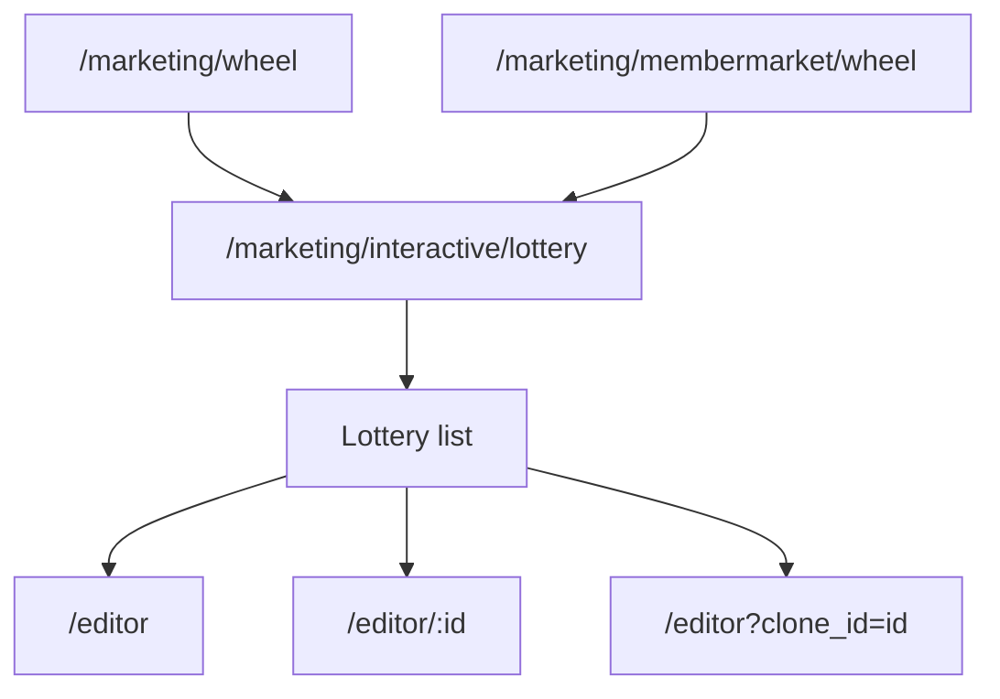
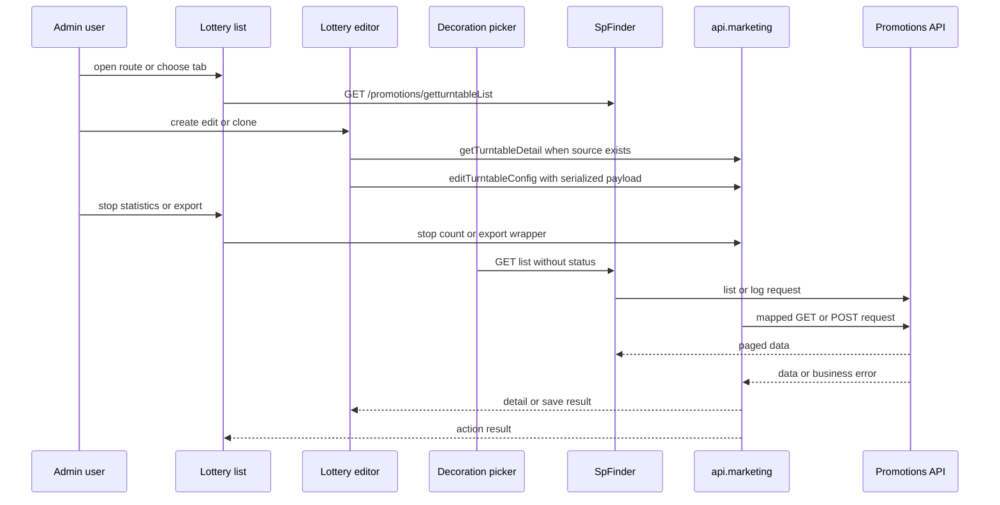
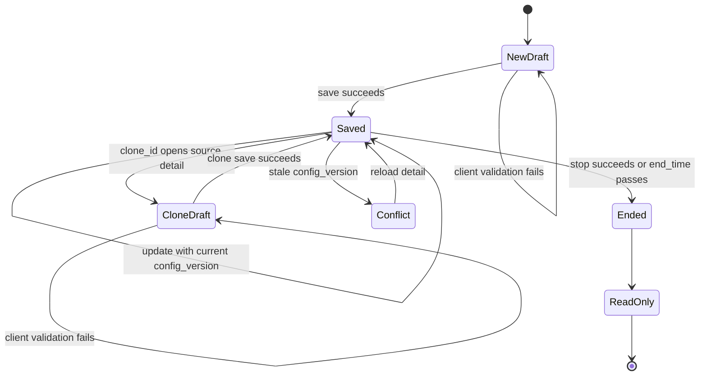
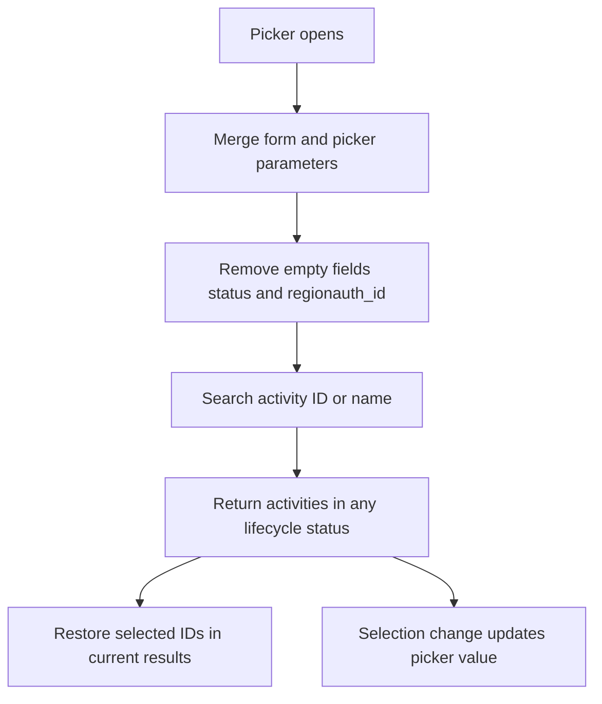

# Lottery Wheel Admin Workflow

## Scope and authority

This is the Admin lifecycle for lottery-wheel activities. It covers the lottery list, create/edit/clone editor, manual termination, statistics and export, and the decoration activity picker. Vshop/H5 consumption is outside this workflow.

Use [`openwiki/api/lottery-wheel-contract.md`](../api/lottery-wheel-contract.md) as the source of truth for Admin HTTP methods, paths, request mapping, transport behavior, and named error codes. Use [`openwiki/marketing/lottery/requirements.md`](../marketing/lottery/requirements.md) for explicit product decisions and acceptance questions. Where the implementation and product decision differ, preserve the discrepancy as a verification item rather than treating either side as silently authoritative.

## Entry points and routing

The current Admin route is `/marketing/interactive/lottery`. It renders `src/view/marketing/lottery/list.vue`; its optional child `editor/:id?` renders `src/view/marketing/lottery/editor.vue`, so the editor URLs are:

- `/marketing/interactive/lottery/editor` for a new activity;
- `/marketing/interactive/lottery/editor/:id` for an existing activity;
- `/marketing/interactive/lottery/editor?clone_id=<id>` for a draft clone.

The compatibility routes `/marketing/wheel` and `/marketing/membermarket/wheel` redirect to `/marketing/interactive/lottery`. Do not document or implement the reverse direction as the current route. `src/router/src/route-marketing.js` contains the older route tree and its compatibility redirect, while the active canonical route and both redirects are in `src/router/routes/modules/marketing.js`.

This route map shows the canonical Admin entrypoint and one-way compatibility redirects.

## End-to-end request flow

The list, picker, and statistics log use `SpFinder` with direct URLs. Detail, save, stop, summary count, and export use named wrappers in `src/api/marketing.js`, exposed through the assembled `api.marketing` object in `src/api/index.js`. Both paths converge on the shared request client and Promotions API.

The sequence shows the two Admin transport entrypoints and their shared Promotions boundary.

## List, tabs, and row actions

`list.vue` loads `/promotions/getturntableList` through `SpFinder`. Search fields are `activity_id` and `activity_name`. The four tabs are `all`, `notstart`, `online`, and `expire`; `all` removes `status`, while the other tabs send the exact matching status value. Rows display the activity identity/type/status, Unix-second time range rendered as local date-time text, and created/updated times.

Row actions are debounced to prevent repeated activation:

- **Edit** routes to `/marketing/interactive/lottery/editor/:id`.
- **Stop** is visible only when `row.status == 'online'`. After confirmation it calls `GET /promotions/down_lucky_draw/byid` with `{ activity_id }`, refreshes the Finder, and shows success. Cancel/close from the confirmation dialog is ignored; other failures prefer the backend message and fall back to a generic error.
- **Copy** routes to `?clone_id=<id>` and starts the editor draft-clone flow. It does not use the optional server-side copy wrapper as the primary Admin path.
- **Statistics** requests the summary count with `{ activity_id }`, then opens the log dialog.

The list action and tab behavior is implemented in `src/view/marketing/lottery/list.vue`, while columns, visibility, and debouncing are in `src/view/marketing/lottery/schema.js`.

## Create, edit, and clone lifecycle

### Detail loading and state

For edit or clone, the editor calls `GET /promotions/getturntable` through `api.marketing.getTurntableDetail({ id })`. It restores the activity name, Unix-second `begin_time`/`end_time` as a date range, limits, rich-text `intro`, prize rows, template configuration, and `config_version`.

A normal edit preserves the activity ID and existing `prize_id` values. The editor locks the existing begin time and consumption value; date changes only replace the end time. A clone loads the source detail but appends ` 副本` to the name, clears the activity ID and `config_version`, clears the date range for a new time selection, and saves as a new activity through the normal configuration endpoint. The optional `api.marketing.copyTurntable` wrapper for `POST /promotions/turntable/copy` exists but is not used by this primary flow.

A detail with an elapsed `end_time` becomes read-only. A detail or save response with `LUCKY_DRAW_ENDED` also switches the editor to read-only. The save path sends the current `config_version` on update; `LUCKY_DRAW_CONFIG_VERSION_CONFLICT` displays a stale-update error and reloads detail before another attempt.

This lifecycle distinguishes a new draft, normal optimistic-lock update, clone draft, terminal state, and stale-version recovery.

### Client validation and invariants

Before save, the editor requires:

- both activity times, with `end_time > begin_time` and `end_time > now`;
- non-empty `intro` after HTML tags are stripped;
- `activity_type` fixed to `wheel`;
- numeric `cost_value` at least `1` in the current implementation;
- at least one `thanks` prize, with no more than eight prize rows;
- total prize probability greater than `0` and no more than `100`;
- every configured prize name present and no longer than five characters;
- non-negative coupon and coupon-pack daily stock, capped at the selected item quantity when a positive quantity is known;
- non-negative limits, normalized to `0`; when `limit_total` is positive, `limit_day` cannot exceed it.

The `thanks` row cannot be renamed, changed to another type, or deleted. Supported prize types are `thanks`, `points`, `coupon`, and `coupons`. Coupon values are normalized from `prize_detail.card_id`; coupon-pack values use `prize_detail.package_id`.

The editor displays points consumption as disabled `cost_type=2`, fixes `activity_type=wheel`, and does not restore or submit `area_id`. The current save code does not submit `cost_type` either. The requirements page records a product decision that `cost_value=0` means free, but the current editor clamps/rejects values below `1`; free-draw behavior is therefore unresolved and must be decided before acceptance.

## Save payload and configuration

Create and update call `POST /promotions/turntableconfig`. The payload includes the activity name, `intro`, fixed `activity_type: 'wheel'`, numeric `cost_value`, normalized `limit_total` and `limit_day`, Unix-second `begin_time` and `end_time`, serialized `prize_data`, and serialized `activity_template_config`. Update additionally includes `id` and the loaded `config_version`.

Each serialized prize contains `sort`, `name`, `type`, `value`, `probability`, `backgroundColor`, compatibility `background`, and `image`; coupon and coupon-pack rows also contain numeric `dailyStock`. Existing `prize_id` is retained on normal edits and omitted for new rows. The same normalized prize array is copied into `activity_template_config.gameConfig.prizes`.

The template configuration carries the wheel background image/color, `gameMarginTop` defaulting to `150px`, wheel blocks, center button configuration, rule button configuration, record button configuration, and visual prize data. Decoration padding defaults to `20`. A successful response with `result` shows success and returns to the canonical list. A response without `result` is treated as save failure.

## Statistics, logs, and export

Statistics first calls `GET /promotions/getturntable_count/byid` with `{ activity_id }`. The dialog displays `total`, `totalGet`, `totalGetUser`, and `totalUser`. Its log table uses the direct Finder URL `promotions/getturntable_log/byid?activity_id=<id>` and maps Finder `pageSize` to backend `page_size`.

The log columns are user ID, member code, prize title, prize type, and creation time. Member code falls back in this order: `user_card_code`, `username`, `member_code`, `mobile`, then `-`. Export calls `GET /promotions/down_lucky_draw/export` with `{ activity_id }`; after success it routes to the export-record area with tab `export_luckdraw_log`. The source does not establish the product rule for whether summary counts include particular result statuses or whether `thanks` is excluded from winning counts, so those counting semantics remain backend/contract verification items.

## Decoration activity picker

`src/components/sp-picker/pickers/picker-lottery.vue` uses the same `/promotions/getturntableList` Finder endpoint and searches by activity ID or name. Its `beforeSearch` hook merges picker parameters and form values, removes empty search fields, and explicitly deletes both `status` and `regionauth_id`. Consequently, the picker deliberately has no status filter: not-started, online, and ended activities remain selectable for decoration. This is an Admin integration behavior, not a statement about user-facing lottery eligibility.

When existing picker values are supplied, `afterSearch` restores matching rows by ID after the current result page loads. Selection changes call `updateVal(selection)`; single-select mode clears the current selection before selecting the new row, while the default is multiple selection unless the value configuration overrides it.

This control flow highlights the intentional omission of a status filter and the selection restoration boundary.

## Failures and focused verification

Lottery-specific business failures currently handled by the Admin are:

- `LUCKY_DRAW_CONFIG_VERSION_CONFLICT`: show the stale-configuration message and reload detail;
- `LUCKY_DRAW_ENDED`: show the ended/read-only message and prevent further editing;
- other rejected operations: show the backend message when available, otherwise a generic operation failure.

Authentication, timeout, locale, and HTTP response handling belong to the shared request layer and are documented by the API contract. The repository requirements page reports no focused lottery test suite. Targeted verification should cover exact tab queries and status omission, detail/form/payload round trips, immutable begin/cost fields, serialized JSON, version conflict recovery, ended read-only behavior, clone identity isolation, stop refresh and repeat-stop handling, summary/log pagination and fallback rendering, export routing, the unresolved `cost_value=0` decision, and picker selection of ended activities.

## Evidence anchors

- `src/router/routes/modules/marketing.js` — canonical route, editor child, and both compatibility redirects.
- `src/router/src/route-marketing.js` — older route tree and compatibility redirect comment.
- `src/api/index.js` — wrapper assembly and response data unwrapping.
- `src/api/marketing.js` — exact lottery detail, save, count, stop, export, log, and optional copy wrappers.
- `src/view/marketing/lottery/list.vue` — list entrypoint, filters, routes, stop, statistics, and export callers.
- `src/view/marketing/lottery/schema.js` — list actions/columns and statistics log schema.
- `src/view/marketing/lottery/editor.vue` — detail lifecycle, validation, payload serialization, clone, optimistic version, and error handling.
- `src/view/marketing/lottery/editorSchema.js` — form controls, prize constraints, and configuration defaults.
- `src/view/marketing/lottery/constants.js` — statuses, prize types, and template defaults.
- `src/components/sp-picker/pickers/picker-lottery.vue` — unfiltered decoration picker and selection restoration.
- `openwiki/api/lottery-wheel-contract.md` — Admin integration authority.
- `openwiki/marketing/lottery/requirements.md` — product decisions, discrepancies, and pending verification.
